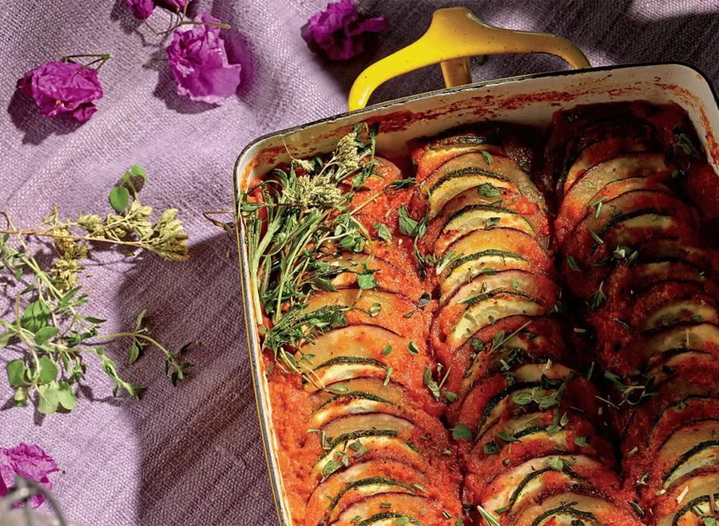

# Bagt ratatouille

* Kilde: https://www.bluezones.com/recipe/roasted-ratatouille/
* Antal: **4 pers.**
* Tid i alt: **60 min.**
* Arbejdstid: **20 min.**

## Vejledende næringsindhold
Beregnede tal fra struktureret YAML-opskrift (både råvægt og estimeret spiseklar vægt efter vandoptag/fordampning).

| Variant                               | Råvægt (g) | Spiseklar (ca., g) | kcal | Protein (g) | Kulhydrat (g) | Fedt (g) | Kostfibre (g) |
| ------------------------------------- | ---------: | -----------------: | ---: | ----------: | ------------: | -------: | ------------: |
| Standard måltid (pr. 100 g spiseklar) |        115 |                100 | 78.3 |         1.3 |           5.5 |      5.8 |           2.4 |
| Standard måltid (pr. portion, 1/4)    |        286 |                248 |  194 |         3.1 |          13.7 |     14.4 |           6.0 |
| Standard måltid (hele opskriften)     |       1143 |                990 |  776 |        12.4 |          54.9 |     57.8 |          24.1 |

Antagelser (kort): Grøntsagerne taber lidt væske under bagning i ovnen (faktor 0.85).

## Ingredienser
### Grøntsager & tomatpuré
- [ ] 2 squash, skåret i 3 mm skiver
- [ ] 1 aubergine, skåret i 3 mm skiver
- [ ] 1 teskefuld salt
- [ ] 0.6 deciliter ekstra jomfru olivenolie
- [ ] 1 rød peberfrugt, renset og grofthakket
- [ ] 0.5 løg, grofthakket
- [ ] 2 blommetomater, grofthakket
- [ ] 2 fed hvidløg, hakket
- [ ] 4 frisk timian, kviste, blade pillet af og hakket
- [ ] 4 frisk oregano, kviste, blade pillet af og hakket
- [ ] 1 frisk rosmarin, kvist, blade pillet af og hakket
- [ ] 0.25 teskefulde friskkværnet sort peber

## Fremgangsmåde
- [ ] Forvarm ovnen til 190°C.
- [ ] Kom squash og aubergine i en stor skål, drys med halvdelen af salt og vend det godt rundt. Tilsæt ca. 2/3 af ekstra jomfru olivenolie og vend igen, så alle skiver er dækket. Sæt til side.
- [ ] Kom rød peberfrugt, løg, blommetomater, hvidløg, halvdelen af frisk timian, frisk oregano og frisk rosmarin, resten af saltet og friskkværnet sort peber i en blender. Kør til en jævn puré.
- [ ] Hæld halvdelen af puréen i bunden af et bredt, rundt ildfast fad og fordel den jævnt.
- [ ] Arranger squash- og aubergineskiverne ovenpå puréen i et mønster (f.eks. taglagt i en spiral), indtil hele fadet er dækket.
- [ ] Hæld resten af puréen over toppen og fordel den jævnt. Drys med resten af krydderurterne.
- [ ] Bag i ovnen i 40 minutter.
- [ ] Tag fadet ud og dryp med den resterende ekstra jomfru olivenolie. Lad retten hvile i 5 minutter inden servering.
