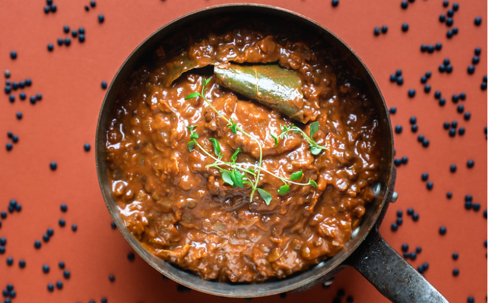

# Beluga Bolognese

* Kilde: https://vegetariskhverdag.dk/2018/12/beluga-bolognese/
* Antal: **6 pers.**
* Tid i alt: **45–90 min.**
* Arbejdstid: **25 min.**

## Vejledende næringsindhold
Beregnede tal fra struktureret YAML-opskrift (både råvægt og estimeret spiseklar vægt efter vandoptag/fordampning).

| Variant                                            | Råvægt (g) | Spiseklar (ca., g) |  kcal | Protein (g) | Kulhydrat (g) | Fedt (g) | Kostfibre (g) |
| -------------------------------------------------- | ---------: | -----------------: | ----: | ----------: | ------------: | -------: | ------------: |
| Standard måltid (pr. 100 g spiseklar)              |         71 |                100 | 133.2 |         4.5 |          20.4 |      2.8 |           1.9 |
| Standard måltid (pr. portion, 1/6)                 |        309 |                438 |   583 |        19.8 |          89.5 |     12.3 |           8.5 |
| Standard måltid (hele opskriften)                  |       1854 |               2628 |  3501 |       118.8 |         537.0 |     74.0 |          51.1 |
| Kun basisret (uden tilbehør) (pr. 100 g spiseklar) |         96 |                100 | 104.8 |         3.3 |           8.5 |      5.0 |           2.4 |
| Kun basisret (uden tilbehør) (pr. portion, 1/6)    |        209 |                218 |   228 |         7.3 |          18.5 |     10.8 |           5.3 |
| Kun basisret (uden tilbehør) (hele opskriften)     |       1254 |               1308 |  1371 |        43.8 |         111.0 |     65.0 |          31.9 |
| Med alle tilvalg (pr. portion, 1/6)                |        338 |                467 |   685 |        23.8 |          90.1 |     21.5 |           8.6 |
| Med alle tilvalg (hele opskriften)                 |       2029 |               2803 |  4111 |       142.8 |         540.4 |    128.9 |          51.6 |

Antagelser (kort): Saucen og pastaen er adskilt i moduler, så du både kan se næringsindholdet for selve bolognesesaucen (f.eks. til frys) og den samlede tallerken med pasta og fløde/parmesan.

## Ingredienser
### Til saucen
- [ ] 3 spiseskefulde olivenolie
- [ ] 1 stort løg, finthakket
- [ ] 3 fed store fed hvidløg, finthakket
- [ ] 1 gulerod, fintrevet
- [ ] 0.5 teskefulde chiliflager (valgfrit)
- [ ] 1 spiseskefuld frisk timian, finthakket (eller 1 tsk tørret)
- [ ] 25 gram smør eller smørbar
- [ ] 2 spiseskefulde tomatpuré
- [ ] 1.5 deciliter rødvin
- [ ] 400 gram passata (mosede tomater) eller hakkede tomater
- [ ] 2 laurbærblade
- [ ] 1 spiseskefuld koncentreret grøntsagsfond eller 1 bouillonterning
- [ ] 2 deciliter vand, plus ekstra efter behov
- [ ] 130 gram belugalinser, skyllet (ca. 1.5 dl)
- [ ] Salt
- [ ] Friskkværnet peber
- [ ] 1 teskefuld sukker (valgfrit)
- [ ] 1 teskefuld eddike (valgfrit)

### Til servering (pasta)
- [ ] 600 gram spaghetti eller anden pasta (tørvægt)

### Tilvalg i saucen (fløde)
- [ ] 1 deciliter fløde (eller 1 dl sødmælk) (valgfrit)

### Topping (parmesan & urter)
- [ ] 60 gram parmesan, fintrevet (ca. 10 g pr. portion) (valgfrit)
- [ ] 1 håndfuld bredbladet persille, finthakket (kan udelades) (valgfrit)

## Fremgangsmåde
- [ ] Varm olivenolie op i en stor gryde ved lav til middel varme. Sautér stort løg i 5–10 minutter, til det er helt blødt og let gyldent.
- [ ] Tilsæt store fed hvidløg, gulerod, chiliflager, frisk timian og smør eller smørbar. Sautér 2 minutter, til det dufter og smørret er smeltet.
- [ ] Skub grøntsagerne til siden. Steg tomatpuré i 1–2 minutter i bunden af gryden, til den bliver mørkere og lidt "ristet" i duften.
- [ ] Hæld rødvin i og lad det koge 1–2 minutter, til det ikke længere dufter sprittet.
- [ ] Rør fløde (eller 1 dl sødmælk) i (hvis du bruger det). Tilsæt passata (mosede tomater) eller hakkede tomater, laurbærblade, koncentreret grøntsagsfond eller 1 bouillonterning og vand. Bring i kog.
- [ ] Skru ned og lad saucen simre under låg i 10–30 minutter, til den smager mere rund og begynder at tykne.
- [ ] Rør belugalinser i. Lad simre 20–25 minutter uden hårdt kog, til linserne er møre men stadig har lidt bid, og saucen kan dække bagsiden af en ske. Tilsæt ekstra vand undervejs, hvis den bliver for tyk.
- [ ] Smag til med salt og masser af friskkværnet peber. Justér efter smag med lidt sukker (hvis den er for syrlig) og en smule eddike (hvis den mangler "kant").
- [ ] Kog spaghetti eller anden pasta (tørvægt) i rigeligt saltet vand, til den er al dente. Server med bolognese, parmesan, peber og evt. bredbladet persille.
