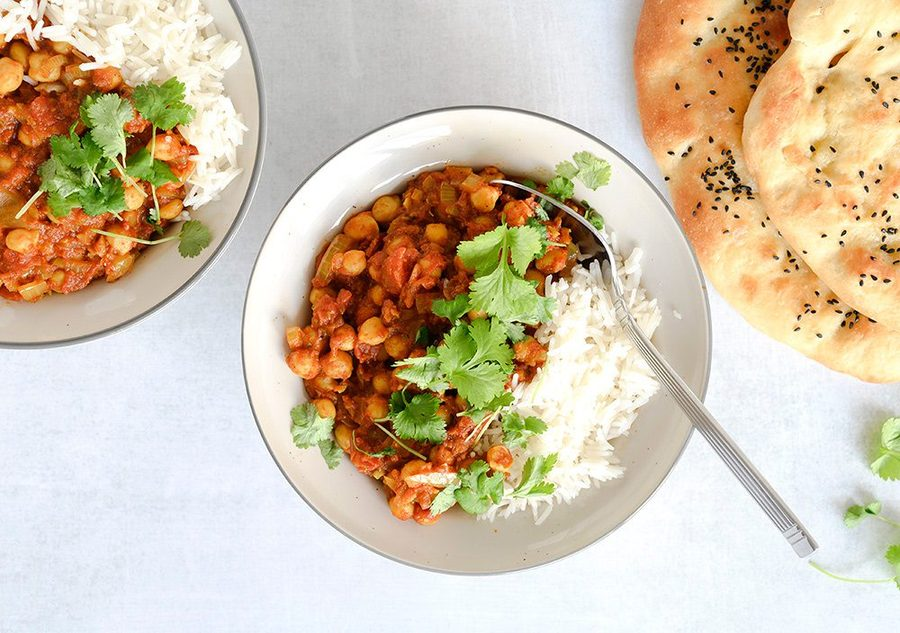

# Chana masala

* Kilde: https://www.valdemarsro.dk/chana-masala/
* Antal: **4 pers.**
* Tid i alt: **30 min.**
* Arbejdstid: **20 min.**

## Vejledende næringsindhold
Beregnede tal fra struktureret YAML-opskrift (både råvægt og estimeret spiseklar vægt efter vandoptag/fordampning).

| Variant                                            | Råvægt (g) | Spiseklar (ca., g) |  kcal | Protein (g) | Kulhydrat (g) | Fedt (g) | Kostfibre (g) |
| -------------------------------------------------- | ---------: | -----------------: | ----: | ----------: | ------------: | -------: | ------------: |
| Standard måltid (pr. 100 g spiseklar)              |         90 |                100 | 104.8 |         3.1 |          15.7 |      2.7 |           2.3 |
| Standard måltid (pr. portion, 1/4)                 |        490 |                543 |   570 |        17.1 |          85.5 |     14.7 |          12.7 |
| Standard måltid (hele opskriften)                  |       1960 |               2173 |  2278 |        68.3 |         342.2 |     58.6 |          50.9 |
| Kun basisret (uden tilbehør) (pr. 100 g spiseklar) |        111 |                100 |  89.9 |         3.3 |           9.3 |      3.7 |           3.1 |
| Kun basisret (uden tilbehør) (pr. portion, 1/4)    |        422 |                380 |   342 |        12.5 |          35.3 |     14.2 |          11.8 |
| Kun basisret (uden tilbehør) (hele opskriften)     |       1690 |               1521 |  1367 |        49.9 |         141.1 |     56.7 |          47.2 |

Antagelser (kort): 3 dl basmatiris svarer til ca. 255–300 g tørvægt (her regnet som 300 g tørvægt = ca. 750 g kogt ris). 2 dåser drænede kikærter = 480 g.

## Ingredienser
### Til chana masala
- [ ] 3 spiseskefulde olivenolie
- [ ] 2 løg, finthakket
- [ ] 2 teskefulde stødt spidskommen
- [ ] 5 fed hvidløg, finthakket
- [ ] 1 spiseskefuld ingefær, fintrevet
- [ ] 0.5 rød chili, finthakket (tilpas efter smag)
- [ ] 2 teskefulde stødt koriander
- [ ] 0.5 teskefulde stødt kardemomme
- [ ] 1 teskefuld stødt gurkemeje
- [ ] 2 teskefulde garam masala
- [ ] 2 dåser hakkede tomater
- [ ] 2 dåser kikærter (drænet), drænet og skyllede
- [ ] 1 deciliter grøntsagsbouillon, plus ekstra efter behov
- [ ] 2 teskefulde sukker
- [ ] 1 teskefuld salt

### Til servering (ris)
- [ ] 3 deciliter basmatiris, kogt efter anvisning på pakken
- [ ] 1 håndfuld frisk koriander, grofthakket

## Fremgangsmåde
- [ ] Varm olivenolie op i en gryde ved middel varme. Sautér løg og stødt spidskommen i 6–8 minutter, til løgene er helt bløde og klare.
- [ ] Tilsæt hvidløg, ingefær og rød chili. Sautér 1 minut, til det dufter.
- [ ] Tilsæt stødt koriander, stødt kardemomme, stødt gurkemeje og garam masala. Rør 30 sekunder, så krydderierne bliver "vakt" i olien.
- [ ] Tilsæt hakkede tomater og kikærter (drænet). Hæld grøntsagsbouillon i og bring i kog.
- [ ] Lad retten simre uden låg i cirka 20 minutter. Rør jævnligt.
- [ ] Smag til med sukker og salt. Hvis den bliver for tyk undervejs, så tilsæt lidt ekstra bouillon.
- [ ] Server med basmatiris og frisk koriander.
