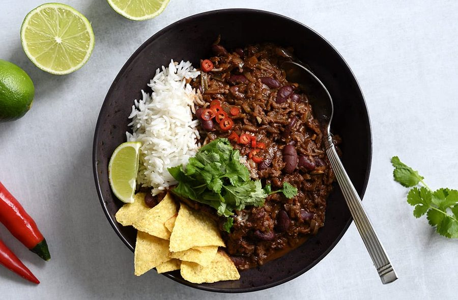

# Chili sin carne

* Kilde: https://www.valdemarsro.dk/chili-sin-carne/
* Antal: **4 pers.**
* Tid i alt: **45 min.**
* Arbejdstid: **15 min.**

## Vejledende næringsindhold
Beregnede tal fra struktureret YAML-opskrift (både råvægt og estimeret spiseklar vægt efter vandoptag/fordampning).

| Variant                                            | Råvægt (g) | Spiseklar (ca., g) |  kcal | Protein (g) | Kulhydrat (g) | Fedt (g) | Kostfibre (g) |
| -------------------------------------------------- | ---------: | -----------------: | ----: | ----------: | ------------: | -------: | ------------: |
| Standard måltid (pr. 100 g spiseklar)              |         93 |                100 | 114.0 |         4.0 |          13.3 |      4.5 |           2.6 |
| Standard måltid (pr. portion, 1/4)                 |        622 |                669 |   762 |        26.9 |          88.8 |     30.1 |          17.2 |
| Standard måltid (hele opskriften)                  |       2486 |               2674 |  3047 |       107.7 |         355.0 |    120.3 |          68.7 |
| Kun basisret (uden tilbehør) (pr. 100 g spiseklar) |        111 |                100 |  86.8 |         3.5 |           8.2 |      3.8 |           3.6 |
| Kun basisret (uden tilbehør) (pr. portion, 1/4)    |        487 |                439 |   381 |        15.2 |          36.1 |     16.8 |          15.8 |
| Kun basisret (uden tilbehør) (hele opskriften)     |       1949 |               1754 |  1522 |        60.9 |         144.3 |     67.3 |          63.2 |
| Med alle tilvalg (pr. portion, 1/4)                |        653 |                700 |   912 |        28.9 |         108.8 |     37.0 |          18.4 |
| Med alle tilvalg (hele opskriften)                 |       2612 |               2799 |  3647 |       115.8 |         435.0 |    147.8 |          73.7 |

Antagelser (kort): Klassisk fyldig chili sin carne fyldt med grøntsager (squash, aubergine og bladselleri), kidneybønner og mørk chokolade. Serveres med ris, sprøde nachos, cremefraiche, revet cheddar, frisk chili, koriander og lime. 3 dl basmatiris (ca. 255–300 g tørvægt) giver ca. 750 g kogte ris. 2 dåser drænede kidneybønner svarer til 480 g.

## Ingredienser
### Til chili sin carne
- [ ] 1.5 teskefulde stødt spidskommen
- [ ] 1 teskefuld stødt kanel
- [ ] 1.5 teskefulde stødt koriander
- [ ] 1 teskefuld røget paprika
- [ ] 0.5 teskefulde chiliflager
- [ ] 3 spiseskefulde olivenolie (til stegning)
- [ ] 2 rødløg, finthakkede
- [ ] 2 fed hvidløg, finthakkede
- [ ] 1 squash, groftrevet
- [ ] 2 stængler bladselleri, groftrevet
- [ ] 1 aubergine, groftrevet
- [ ] 3 spiseskefulde soltørrede tomater i olie, finthakkede
- [ ] 1 dåse hakkede tomater på dåse
- [ ] 1 deciliter grøntsagsbouillon
- [ ] 2 dåser kidneybønner (drænet), drænede og skyllede
- [ ] 30 gram mørk chokolade
- [ ] Salt
- [ ] Friskkværnet peber

### Til servering (ris)
- [ ] 3 deciliter basmatiris, kogt efter anvisning på pakken

### Til servering (cremefraiche, cheddar & urter)
- [ ] 100 gram cremefraiche 18 %
- [ ] 100 gram cheddar, revet
- [ ] 0.5 rød chili, finthakket (juster efter smag)
- [ ] 1 håndfuld frisk koriander, grofthakket
- [ ] 1 lime, skåret i både

### Tilbehør (nachos)
- [ ] 125 gram nachos (eller tortillachips) (valgfrit)

## Fremgangsmåde
- [ ] Kog basmatiris efter anvisningen på pakken, så de er klar ved servering.
- [ ] Varm en tør sauterpande eller en stor gryde op ved middel varme. Tilsæt stødt spidskommen, stødt kanel, stødt koriander, røget paprika og chiliflager, og rist krydderierne igennem under omrøring i 1–2 minutter, til de dufter kraftigt.
- [ ] Skru en smule ned for varmen og tilsæt olivenolie (til stegning), rødløg og hvidløg. Sautér i 3–5 minutter, til løgene er bløde og klare.
- [ ] Tilsæt squash, aubergine, stængler bladselleri, hakkede tomater på dåse, soltørrede tomater i olie og grøntsagsbouillon. Rør det godt sammen, læg låg på og lad retten simre ved svag varme i 30 minutter.
- [ ] Skyl og afdryp kidneybønner (drænet), tilsæt dem til gryden, og lad retten simre videre under låg i 5 minutter, til bønnerne er gennemvarme.
- [ ] Tag gryden af varmen og rør mørk chokolade i — start med halvdelen og smag til med resten samt salt og friskkværnet peber (tilsæt evt. ekstra chili, hvis retten skal være stærkere).
- [ ] Anret den varme chili sin carne i skåle og servér med de kogte basmatiris, sprøde nachos (eller tortillachips), en klat cremefraiche 18 %, revet cheddar, rød chili, frisk koriander og både af lime til at presse over.
