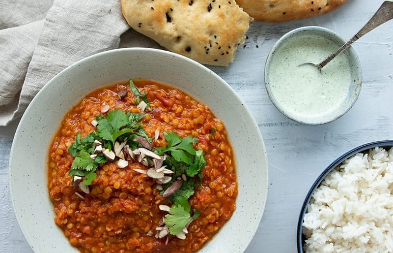

# Dhal

* Kilde: https://www.valdemarsro.dk/dhal/
* Antal: **4 pers.**
* Tid i alt: **60 min.**
* Arbejdstid: **15 min.**

## Vejledende næringsindhold
Beregnede tal fra struktureret YAML-opskrift (både råvægt og estimeret spiseklar vægt efter vandoptag/fordampning).

| Variant                                            | Råvægt (g) | Spiseklar (ca., g) |  kcal | Protein (g) | Kulhydrat (g) | Fedt (g) | Kostfibre (g) |
| -------------------------------------------------- | ---------: | -----------------: | ----: | ----------: | ------------: | -------: | ------------: |
| Standard måltid (pr. 100 g spiseklar)              |         84 |                100 | 122.4 |         4.5 |          12.3 |      5.6 |           1.6 |
| Standard måltid (pr. portion, 1/4)                 |        663 |                788 |   965 |        35.4 |          97.2 |     44.3 |          12.8 |
| Standard måltid (hele opskriften)                  |       2650 |               3152 |  3859 |       141.6 |         388.8 |    177.1 |          51.1 |
| Kun basisret (uden tilbehør) (pr. 100 g spiseklar) |         94 |                100 | 124.8 |         5.2 |           8.2 |      7.3 |           2.1 |
| Kun basisret (uden tilbehør) (pr. portion, 1/4)    |        502 |                532 |   664 |        27.7 |          43.6 |     38.7 |          11.3 |
| Kun basisret (uden tilbehør) (hele opskriften)     |       2010 |               2129 |  2658 |       110.8 |         174.5 |    154.7 |          45.1 |
| Med alle tilvalg (pr. portion, 1/4)                |        700 |                825 |  1101 |        36.1 |          98.3 |     58.5 |          12.8 |
| Med alle tilvalg (hele opskriften)                 |       2800 |               3302 |  4405 |       144.6 |         393.3 |    234.1 |          51.1 |

Antagelser (kort): Røde linser optager væske under simring (faktor 2.5x). Mængder er lagret i kanoniske enheder (g, ml, stk) og vises automatisk i danske køkkenmål (f.eks. 7.5 ml -> ½ spsk / 2 tsk ved skalering).

## Ingredienser
### Til dhal
- [ ] 2 spiseskefulde olivenolie
- [ ] 2 løg, finthakket
- [ ] 4 fed hvidløg, finthakket
- [ ] 2–3 spiseskefulde frisk ingefær, fintrevet
- [ ] 2–3 spiseskefulde gul karry
- [ ] 0.5 spiseskefulde stødt spidskommen
- [ ] 0.5 spiseskefulde stødt koriander
- [ ] 0–0.5 teskefulde stødt kardemomme
- [ ] 0.5 teskefulde chiliflager eller chilipulver
- [ ] 200 gram røde linser, skyllet
- [ ] 2 dåser hakkede tomater
- [ ] 1 grøntsagsbouillonterning
- [ ] 400 milliliter kokosmælk
- [ ] 100 milliliter vand, valgfrit, efter konsistens
- [ ] 200 gram paneer, skåret i tern
- [ ] Salt

### Til raita
- [ ] 2 deciliter græsk yoghurt 10 %
- [ ] 0.5 agurk, groftrevet og let afdryppet
- [ ] 1 fed hvidløg, presset
- [ ] 1 håndfuld frisk mynte, finthakket
- [ ] 0.5 teskefulde stødt spidskommen
- [ ] Salt
- [ ] Friskkværnet sort peber
- [ ] 1 håndfuld frisk koriander, grofthakket

### Tilvalg (fløde)
- [ ] 100–200 milliliter fløde (valgfrit)

### Til servering (ris - valgfrit)
- [ ] 3 deciliter basmatiris, tørvægt (kogt efter anvisning, hvis man ønsker ris til) (valgfrit)

## Fremgangsmåde
- [ ] Varm olivenolie op i en stor gryde ved middel varme. Sautér løg 6–8 minutter, til de er bløde og klare.
- [ ] Tilsæt hvidløg og frisk ingefær og sautér 1 minut, til det dufter.
- [ ] Tilsæt gul karry, stødt spidskommen, stødt koriander, stødt kardemomme og chiliflager eller chilipulver. Rør 30–60 sekunder, så krydderierne bliver "vakt" i olien.
- [ ] Tilsæt røde linser, hakkede tomater, grøntsagsbouillonterning, kokosmælk og vand. Bring i kog.
- [ ] Skru ned og lad dhal simre under låg i 30–45 minutter, til linserne er helt møre og retten er cremet. Rør jævnligt, så det ikke sætter sig i bunden. Justér med lidt ekstra vand, hvis den bliver for tyk.
- [ ] Steg paneer på en pande ved siden af, til ternene er gyldne på flere sider.
- [ ] Når dhal er klar: Vend paneer i og varm 3–5 minutter. Rør fløde i til sidst, hvis du bruger det.
- [ ] Smag til med salt.

### Raita
- [ ] Rør græsk yoghurt 10 %, agurk, hvidløg, frisk mynte, stødt spidskommen, salt og peber sammen. Vend frisk koriander i.
- [ ] Server dhal varm med kølig raita ved siden af (og evt. basmatiris).
