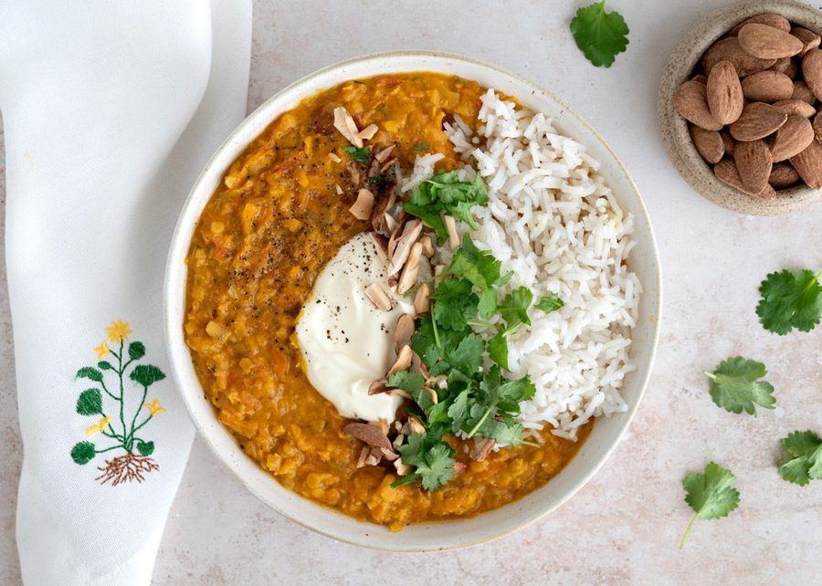

# Grøntsagsdhal

* Kilde: https://www.valdemarsro.dk/groentsagsdhal/
* Antal: **4 pers.**
* Tid i alt: **45 min.**
* Arbejdstid: **20 min.**

## Vejledende næringsindhold
Beregnede tal fra struktureret YAML-opskrift (både råvægt og estimeret spiseklar vægt efter vandoptag/fordampning).

| Variant                                            | Råvægt (g) | Spiseklar (ca., g) |  kcal | Protein (g) | Kulhydrat (g) | Fedt (g) | Kostfibre (g) |
| -------------------------------------------------- | ---------: | -----------------: | ----: | ----------: | ------------: | -------: | ------------: |
| Standard måltid (pr. 100 g spiseklar)              |         88 |                100 | 103.6 |         3.5 |          10.6 |      4.7 |           2.0 |
| Standard måltid (pr. portion, 1/4)                 |        671 |                759 |   786 |        26.5 |          80.6 |     35.8 |          15.0 |
| Standard måltid (hele opskriften)                  |       2685 |               3036 |  3144 |       105.9 |         322.3 |    143.0 |          60.1 |
| Kun basisret (uden tilbehør) (pr. 100 g spiseklar) |         96 |                100 |  86.2 |         3.2 |           7.3 |      4.4 |           2.1 |
| Kun basisret (uden tilbehør) (pr. portion, 1/4)    |        588 |                612 |   527 |        19.4 |          44.9 |     26.7 |          12.9 |
| Kun basisret (uden tilbehør) (hele opskriften)     |       2350 |               2446 |  2110 |        77.8 |         179.4 |    106.7 |          51.5 |

Antagelser (kort): Fyldig grøntsagsdhal med røde linser, gulerødder, squash, blomkål og babyspinat i en cremet kokos- og karrybase. Serveres med basmatiris, saltede mandler og græsk yoghurt.

## Ingredienser
### Til grøntsagsdhal
- [ ] 2 spiseskefulde olivenolie
- [ ] 2 løg, finthakket
- [ ] 3 teskefulde mediumstærk karry
- [ ] 0.5 teskefulde chiliflager
- [ ] 1 teskefuld stødt spidskommen
- [ ] 1 teskefuld stødt koriander
- [ ] 200 gram røde linser, skyllet
- [ ] 250 gram gulerødder, groftrevet
- [ ] 150 gram squash, i små tern
- [ ] 4 fed hvidløg, fintrevet
- [ ] 2 spiseskefulde ingefær, fintrevet
- [ ] 4 deciliter grøntsagsbouillon
- [ ] 1 dåse kokosmælk
- [ ] 1 dåse hakkede tomater
- [ ] 200 gram blomkål, finthakket
- [ ] 75 gram babyspinat
- [ ] Salt
- [ ] Friskkværnet peber

### Til servering (ris)
- [ ] 2 deciliter basmatiris

### Tilbehør og topping ved servering
- [ ] 50 gram saltede mandler, grofthakkede
- [ ] 1 deciliter græsk yoghurt 10 %
- [ ] 1 håndfuld frisk koriander, finthakket

## Fremgangsmåde
- [ ] Kog basmatiris efter anvisningen på pakken.
- [ ] Varm olivenolie op i en stor gryde ved middel varme og sautér løg i 4–5 minutter, til de er bløde og klare.
- [ ] Tilsæt mediumstærk karry, chiliflager, stødt spidskommen og stødt koriander, og varm krydderierne igennem under omrøring i ca. 1 minut.
- [ ] Skyl røde linser i en sigte og kom dem i gryden sammen med gulerødder, squash, hvidløg, ingefær, grøntsagsbouillon, kokosmælk og hakkede tomater.
- [ ] Bring i kog, læg låg på og lad retten simre ved svag varme i 20 minutter.
- [ ] Tilsæt blomkål, rør godt rundt, læg låg på igen og lad simre i yderligere 10–15 minutter (tilsæt evt. en smule ekstra vand eller bouillon, hvis dhalen bliver for fast).
- [ ] Smag til med salt og friskkværnet peber, og vend babyspinat i gryden, så den lige falder sammen.
- [ ] Server i dybe skåle med basmatiris, toppet med græsk yoghurt 10 %, saltede mandler og et drys frisk koriander.
