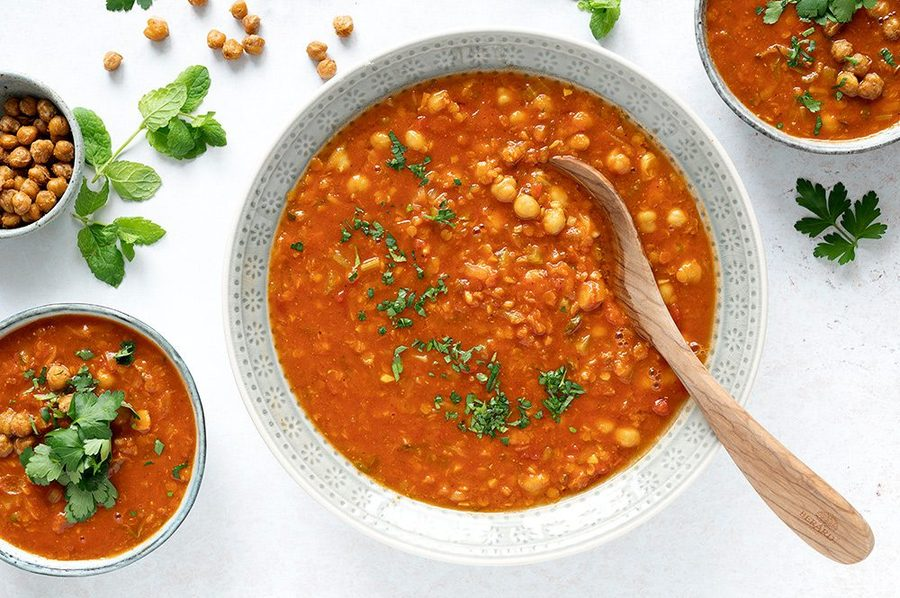

# Harira

* Kilde: https://www.valdemarsro.dk/harira-marokkansk-suppe/
* Antal: **4 pers.**
* Tid i alt: **35 min.**
* Arbejdstid: **20 min.**

## Vejledende næringsindhold
Beregnede tal fra struktureret YAML-opskrift (både råvægt og estimeret spiseklar vægt efter vandoptag/fordampning).

| Variant                                            | Råvægt (g) | Spiseklar (ca., g) | kcal | Protein (g) | Kulhydrat (g) | Fedt (g) | Kostfibre (g) |
| -------------------------------------------------- | ---------: | -----------------: | ---: | ----------: | ------------: | -------: | ------------: |
| Standard måltid (pr. 100 g spiseklar)              |        103 |                100 | 65.7 |         2.9 |           7.0 |      2.4 |           2.4 |
| Standard måltid (pr. portion, 1/4)                 |        633 |                617 |  405 |        18.1 |          43.0 |     14.9 |          14.6 |
| Standard måltid (hele opskriften)                  |       2533 |               2466 | 1619 |        72.6 |         172.1 |     59.7 |          58.2 |
| Kun basisret (uden tilbehør) (pr. 100 g spiseklar) |        103 |                100 | 53.9 |         2.5 |           6.1 |      1.8 |           1.9 |
| Kun basisret (uden tilbehør) (pr. portion, 1/4)    |        561 |                544 |  293 |        13.6 |          33.0 |      9.9 |          10.2 |
| Kun basisret (uden tilbehør) (hele opskriften)     |       2242 |               2175 | 1173 |        54.2 |         131.8 |     39.8 |          40.9 |

Antagelser (kort): Marokkansk fyldig suppe med røde linser og kikærter. De sprøde ristede kikærter til topping kan slås til/fra som modul.

## Ingredienser
### Til suppen
- [ ] 1 spiseskefuld stødt spidskommen
- [ ] 1 spiseskefuld stødt koriander
- [ ] 2 spiseskefulde olivenolie
- [ ] 2 løg, finthakkede
- [ ] 3 fed hvidløg, finthakkede
- [ ] 2 stængler bladselleri, skåret i tern
- [ ] 50 gram tomatpuré
- [ ] 1 dåse hakkede tomater
- [ ] 100 gram squash, groftrevet
- [ ] 1 teskefuld stødt gurkemeje
- [ ] 1 spiseskefuld ingefær, fintrevet
- [ ] 0.5 rød chili, finthakket
- [ ] 1 teskefuld sød paprika
- [ ] 1 teskefuld røget paprika
- [ ] 1 knivspids stødt safran
- [ ] 1000 milliliter grøntsagsbouillon
- [ ] 1 dåse kikærter (drænet), drænede og skyllede
- [ ] 75 gram røde linser
- [ ] 4 teskefulde saft af 0,5 citron
- [ ] Salt
- [ ] Friskkværnet peber

### Til ristede kikærter (topping)
- [ ] 1 dåse kikærter (drænet), drænede og skyllede
- [ ] 1 spiseskefuld olivenolie
- [ ] 0.5 teskefulde røget paprika
- [ ] 1 teskefuld flagesalt
- [ ] 1 håndfuld frisk mynte (valgfrit)
- [ ] 1 håndfuld frisk persille (valgfrit)

## Fremgangsmåde
- [ ] Tænd ovnen på 175°C varmluft, hvis du vil lave ristede kikærter.
- [ ] Rist stødt spidskommen og stødt koriander i en tør gryde ved middel varme i 30–60 sekunder, til det dufter.
- [ ] Tilsæt olivenolie, løg og hvidløg. Sautér 5–7 minutter, til løgene er bløde og klare.
- [ ] Tilsæt stængler bladselleri og sautér 2 minutter.
- [ ] Tilsæt tomatpuré og steg 1 minut, til den dufter mere "ristet".
- [ ] Tilsæt hakkede tomater, squash, stødt gurkemeje, ingefær, rød chili, sød paprika, røget paprika og stødt safran.
- [ ] Hæld grøntsagsbouillon i og tilsæt kikærter (drænet) og røde linser. Bring i kog.
- [ ] Læg låg på, skru ned og lad suppen simre 20–25 minutter, til linserne er møre og suppen er let cremet.
- [ ] Smag til med saft af 0,5 citron, salt og friskkværnet peber.

### Ristede kikærter
- [ ] Vend kikærter (drænet) med olivenolie, røget paprika og flagesalt. Fordel dem på en bageplade med bagepapir.
- [ ] Bag i 20–25 minutter, til de er sprøde og let gyldne. Vend dem et par gange undervejs.
- [ ] Server suppen rygende varm med ristede kikærter og evt. frisk mynte og frisk persille på toppen.
