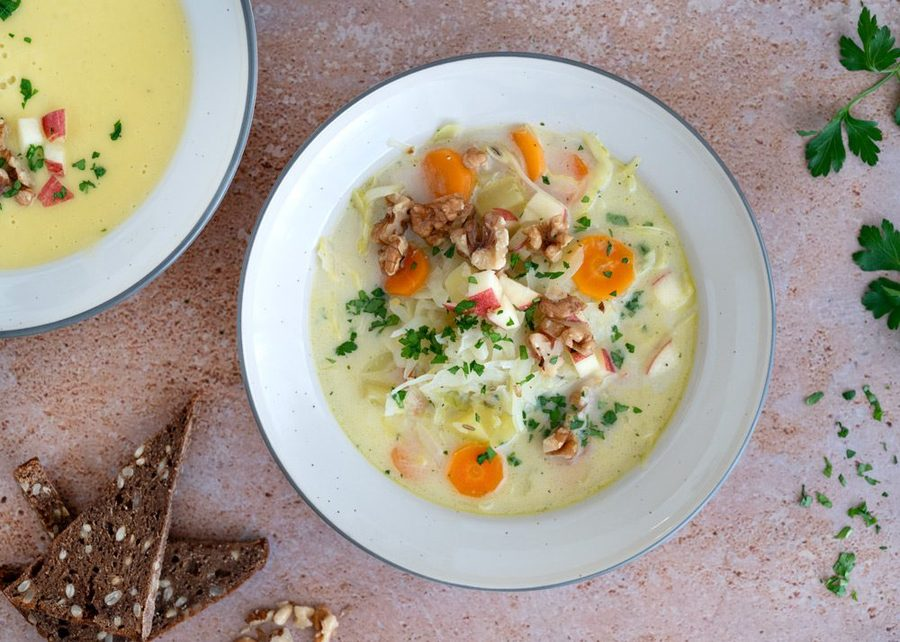

# Hvidkålssuppe

* Kilde: https://www.valdemarsro.dk/hvidkaalssuppe/
* Antal: **4 pers.**
* Tid i alt: **30 min.**
* Arbejdstid: **30 min.**

## Vejledende næringsindhold
Beregnede tal fra struktureret YAML-opskrift (både råvægt og estimeret spiseklar vægt efter vandoptag/fordampning).

| Variant                                            | Råvægt (g) | Spiseklar (ca., g) | kcal | Protein (g) | Kulhydrat (g) | Fedt (g) | Kostfibre (g) |
| -------------------------------------------------- | ---------: | -----------------: | ---: | ----------: | ------------: | -------: | ------------: |
| Standard måltid (pr. 100 g spiseklar)              |        107 |                100 | 69.5 |         1.6 |           8.1 |      3.3 |           1.9 |
| Standard måltid (pr. portion, 1/4)                 |        687 |                641 |  446 |        10.5 |          51.8 |     21.1 |          11.9 |
| Standard måltid (hele opskriften)                  |       2749 |               2565 | 1783 |        42.1 |         207.2 |     84.3 |          47.6 |
| Kun basisret (uden tilbehør) (pr. 100 g spiseklar) |        108 |                100 | 50.8 |         1.2 |           5.9 |      2.5 |           1.2 |
| Kun basisret (uden tilbehør) (pr. portion, 1/4)    |        602 |                556 |  283 |         6.4 |          32.7 |     13.7 |           6.7 |
| Kun basisret (uden tilbehør) (hele opskriften)     |       2409 |               2225 | 1131 |        25.7 |         130.7 |     54.7 |          26.9 |

Antagelser (kort): Cremet hvidkålssuppe med kartofler. Rugbrød og æble/valnødde-topping er adskilt i eget modul.

## Ingredienser
### Til suppen
- [ ] 1 spiseskefuld olivenolie
- [ ] 2 løg, finthakkede
- [ ] 4 fed hvidløg, finthakkede
- [ ] 400 gram kartofler, skåret i små tern
- [ ] 500 gram hvidkål, skåret i tynde strimler
- [ ] 2 gulerødder, skåret i tynde skiver
- [ ] 1 teskefuld fennikelfrø
- [ ] 1000 milliliter grøntsagsbouillon
- [ ] 1 spiseskefuld sojasauce
- [ ] 1 deciliter piskefløde
- [ ] Salt
- [ ] Friskkværnet sort peber

### Til servering (rugbrød, æble & valnødder)
- [ ] 4 skiver rugbrød, ristet
- [ ] 1 æble, skåret i små tern
- [ ] 40 gram valnødder, grofthakket
- [ ] 1 håndfuld persille, finthakket

## Fremgangsmåde
- [ ] Varm olivenolie op i en stor gryde ved middel varme. Sautér løg og hvidløg 5–7 minutter, til løgene er bløde og klare.
- [ ] Tilsæt kartofler, hvidkål, gulerødder og fennikelfrø. Rør rundt i 1 minut.
- [ ] Hæld grøntsagsbouillon i og bring i kog. Læg låg på og lad suppen simre, til kartoflerne er møre (10–15 minutter).
- [ ] Tilsæt sojasauce og piskefløde. Smag til med salt og friskkværnet peber.
- [ ] Blend suppen helt cremet, eller lad grøntsagerne være hele, hvis du vil have en mere rustik suppe.
- [ ] Server varm med ristet skiver rugbrød og topping af æble, valnødder og persille.
