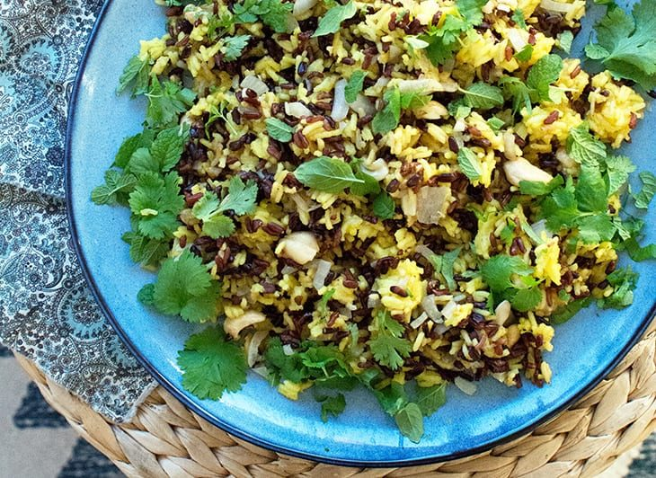

# Indiske ris

* Kilde: https://www.valdemarsro.dk/indiske-ris/
* Antal: **4 pers.**
* Tid i alt: **40 min.**
* Arbejdstid: **15 min.**

## Vejledende næringsindhold
Beregnede tal fra struktureret YAML-opskrift (både råvægt og estimeret spiseklar vægt efter vandoptag/fordampning).

| Variant                                            | Råvægt (g) | Spiseklar (ca., g) |  kcal | Protein (g) | Kulhydrat (g) | Fedt (g) | Kostfibre (g) |
| -------------------------------------------------- | ---------: | -----------------: | ----: | ----------: | ------------: | -------: | ------------: |
| Standard måltid (pr. 100 g spiseklar)              |         63 |                100 | 202.6 |         5.7 |          24.0 |      9.0 |           1.3 |
| Standard måltid (pr. portion, 1/4)                 |        183 |                292 |   591 |        16.8 |          69.9 |     26.2 |           3.8 |
| Standard måltid (hele opskriften)                  |        730 |               1167 |  2364 |        67.0 |         279.5 |    104.9 |          15.3 |
| Kun basisret (uden tilbehør) (pr. 100 g spiseklar) |         55 |                100 | 183.2 |         3.2 |          28.3 |      6.1 |           1.6 |
| Kun basisret (uden tilbehør) (pr. portion, 1/4)    |        133 |                242 |   443 |         7.8 |          68.4 |     14.7 |           3.8 |
| Kun basisret (uden tilbehør) (hele opskriften)     |        530 |                967 |  1772 |        31.0 |         273.5 |     58.9 |          15.3 |
| Med alle tilvalg (pr. portion, 1/4)                |        258 |                367 |   685 |        20.6 |          72.7 |     33.7 |           3.8 |
| Med alle tilvalg (hele opskriften)                 |       1030 |               1467 |  2742 |        82.6 |         290.9 |    134.9 |          15.3 |

Antagelser (kort): Krydrede indiske ris med dadler og cashewnødder. Paneer og græsk yoghurt (raita) kan slås til/fra som valgfrie moduler.

## Ingredienser
### Til de indiske ris
- [ ] 3 deciliter basmatiris
- [ ] 0.5 deciliter sorte ris
- [ ] 3 spiseskefulde olivenolie
- [ ] 1 løg, finthakket
- [ ] 2 fed hvidløg, finthakkede
- [ ] 2 dadler, finthakkede
- [ ] 1 teskefuld stødt gurkemeje
- [ ] 1 knivspids cayennepeber
- [ ] 1 teskefuld stødt kardemomme
- [ ] 1 teskefuld kanel
- [ ] 0.5 teskefulde stødt nellike
- [ ] 1 teskefuld stødt spidskommen
- [ ] 30 gram cashewnødder
- [ ] 1 håndfuld frisk koriander
- [ ] Salt
- [ ] Friskkværnet sort peber

### Valgfrit (paneer - ekstra protein)
- [ ] 200 gram paneer, i tern (valgfrit)

### Til servering (græsk yoghurt / raita)
- [ ] 300 gram græsk yoghurt (raita) (valgfrit)

## Fremgangsmåde
- [ ] Kog basmatiris og sorte ris efter anvisningen på pakken. (Hvis de sorte ris har længere kogetid, så start dem lidt før.)
- [ ] Varm olivenolie op på en pande ved middel varme. Sautér løg og hvidløg 4–5 minutter, til løgene er bløde og klare.
- [ ] Tilsæt dadler, stødt gurkemeje, cayennepeber, stødt kardemomme, kanel, stødt nellike og stødt spidskommen og rør 30–60 sekunder, til det dufter.
- [ ] Valgfrit: steg paneer gyldne på panden og tag dem af.
- [ ] Vend de kogte ris og cashewnødder i. Varm det hele igennem i 3–5 minutter under omrøring.
- [ ] Vend evt. paneer i til sidst.
- [ ] Smag til med salt og friskkværnet peber. Drys frisk koriander over og servér (evt. med græsk yoghurt (raita) ved siden af).
