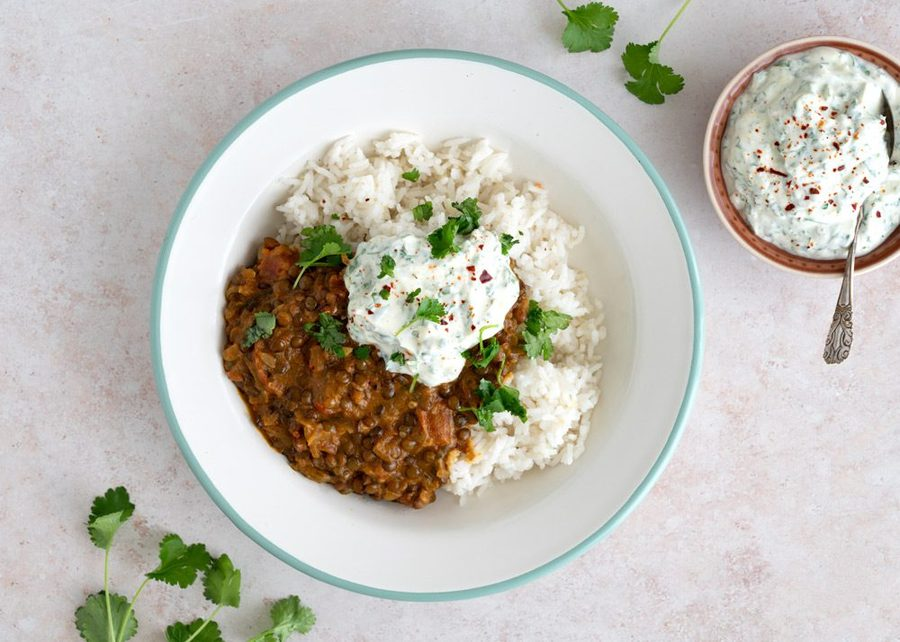

# Linsekarry med ris

* Kilde: https://www.valdemarsro.dk/linsekarry-med-ris/
* Antal: **4 pers.**
* Tid i alt: **45 min.**
* Arbejdstid: **30 min.**

## Vejledende næringsindhold
Beregnede tal fra struktureret YAML-opskrift (både råvægt og estimeret spiseklar vægt efter vandoptag/fordampning).

| Variant                                            | Råvægt (g) | Spiseklar (ca., g) |  kcal | Protein (g) | Kulhydrat (g) | Fedt (g) | Kostfibre (g) |
| -------------------------------------------------- | ---------: | -----------------: | ----: | ----------: | ------------: | -------: | ------------: |
| Standard måltid (pr. 100 g spiseklar)              |         90 |                100 | 111.0 |         3.1 |          13.4 |      4.7 |           1.4 |
| Standard måltid (pr. portion, 1/4)                 |        558 |                622 |   690 |        19.2 |          83.1 |     29.0 |           8.8 |
| Standard måltid (hele opskriften)                  |       2233 |               2486 |  2760 |        76.8 |         332.5 |    115.9 |          35.4 |
| Kun basisret (uden tilbehør) (pr. 100 g spiseklar) |        111 |                100 | 135.2 |         4.5 |          10.5 |      7.7 |           2.6 |
| Kun basisret (uden tilbehør) (pr. portion, 1/4)    |        323 |                291 |   393 |        13.1 |          30.6 |     22.5 |           7.6 |
| Kun basisret (uden tilbehør) (hele opskriften)     |       1292 |               1163 |  1573 |        52.3 |         122.3 |     90.0 |          30.3 |

Antagelser (kort): Linsekarry med grønne linser, krydrede ingefær-ris og citronyoghurt.

## Ingredienser
### Linsekarry
- [ ] 1 spiseskefuld karry
- [ ] 1 spiseskefuld olivenolie
- [ ] 1 løg, finthakket
- [ ] 3 fed hvidløg, finthakkede
- [ ] 1 spiseskefuld ingefær, fintrevet
- [ ] 150 gram grønne linser
- [ ] 200 gram squash, skåret i små tern
- [ ] 1 dåse hakkede tomater
- [ ] 1 dåse kokosmælk
- [ ] Salt
- [ ] Friskkværnet peber

### Ris med ingefær
- [ ] 1 spiseskefuld olivenolie
- [ ] 1 spiseskefuld ingefær, fintrevet
- [ ] 1 fed hvidløg, presset
- [ ] 5 deciliter vand
- [ ] 3 deciliter basmatiris
- [ ] 0.5 teskefulde salt

### Yoghurt (til servering)
- [ ] 1 deciliter græsk yoghurt
- [ ] 1 håndfuld frisk koriander, finthakket
- [ ] 0.5 økologisk citron (fintrevet skal og saft)
- [ ] Salt
- [ ] Friskkværnet peber

## Fremgangsmåde
- [ ] Varm olivenolie op i en gryde ved lav varme. Sautér ingefær og hvidløg 30–60 sekunder, til det dufter, men uden at det tager farve.
- [ ] Tilsæt vand, basmatiris og salt. Bring langsomt i kog, læg låg på og lad risene koge ved svag varme i 10 minutter.
- [ ] Sluk og lad risene hvile 10 minutter med låget på. Løsn dem med en gaffel.

### Linsekarry
- [ ] Rist karry på en tør pande ved middel varme i 30 sekunder, til det dufter.
- [ ] Varm olivenolie op i en gryde ved middel varme. Sautér løg, hvidløg og ingefær 4–5 minutter, til løgene er bløde og klare.
- [ ] Tilsæt grønne linser, squash, hakkede tomater og kokosmælk. Rør godt rundt og bring i kog.
- [ ] Skru ned, læg låg på og lad karryen simre 30–40 minutter, til linserne er møre. Rør af og til.
- [ ] Smag til med salt og friskkværnet peber.

### Yoghurt
- [ ] Rør græsk yoghurt med frisk koriander samt skal og lidt saft fra økologisk citron (fintrevet skal og saft). Smag til med salt og peber.
