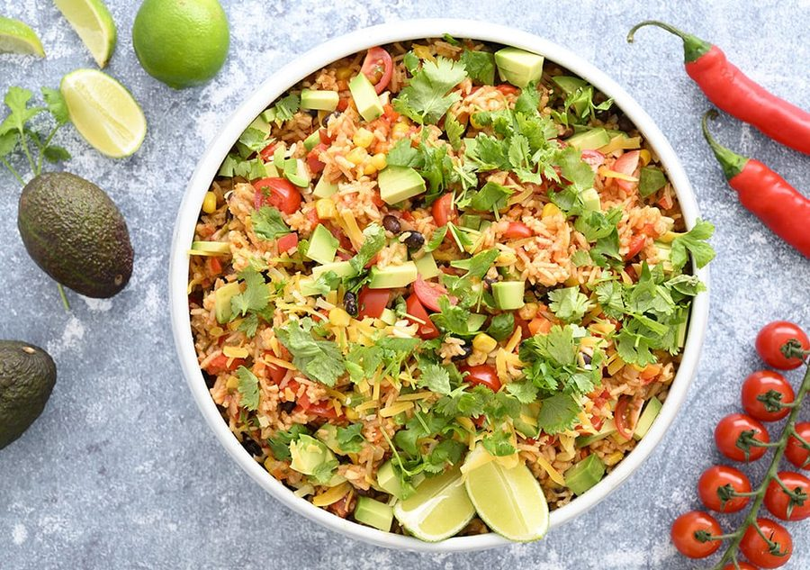

# Mexikansk risret

* Kilde: https://www.valdemarsro.dk/mexicansk-risret/
* Antal: **4 pers.**
* Tid i alt: **45 min.**
* Arbejdstid: **30 min.**

## Vejledende næringsindhold
Beregnede tal fra struktureret YAML-opskrift (både råvægt og estimeret spiseklar vægt efter vandoptag/fordampning).

| Variant                                            | Råvægt (g) | Spiseklar (ca., g) | kcal | Protein (g) | Kulhydrat (g) | Fedt (g) | Kostfibre (g) |
| -------------------------------------------------- | ---------: | -----------------: | ---: | ----------: | ------------: | -------: | ------------: |
| Standard måltid (pr. 100 g spiseklar)              |         93 |                100 | 90.3 |         2.9 |          11.7 |      3.5 |           1.9 |
| Standard måltid (pr. portion, 1/4)                 |        798 |                858 |  775 |        24.6 |         100.5 |     30.0 |          16.2 |
| Standard måltid (hele opskriften)                  |       3192 |               3433 | 3099 |        98.5 |         401.8 |    120.1 |          64.7 |
| Kun basisret (uden tilbehør) (pr. 100 g spiseklar) |         92 |                100 | 74.8 |         2.1 |          12.4 |      1.7 |           1.7 |
| Kun basisret (uden tilbehør) (pr. portion, 1/4)    |        699 |                759 |  568 |        15.7 |          94.2 |     13.0 |          12.6 |
| Kun basisret (uden tilbehør) (hele opskriften)     |       2795 |               3037 | 2270 |        62.6 |         377.0 |     52.0 |          50.3 |

Antagelser (kort): One-pot mexicansk risret med sorte bønner og grøntsager. Topping med avocado og cheddar kan slås til/fra som modul.

## Ingredienser
### Til risretten
- [ ] 3 spiseskefulde olivenolie
- [ ] 2 løg, finthakkede
- [ ] 4 fed hvidløg, finthakkede
- [ ] 2 gulerødder, skåret i små tern
- [ ] 1 squash, groftrevet
- [ ] 0.5 rød chili, uden kerner og finthakket
- [ ] 2 teskefulde stødt spidskommen
- [ ] 2 teskefulde stødt koriander
- [ ] 0.5 teskefulde kanel
- [ ] 2 teskefulde røget paprika
- [ ] 300 gram basmatiris, skyllet
- [ ] 6 deciliter grøntsagsbouillon
- [ ] 1 dåse hakkede tomater
- [ ] 0.6 dåser sorte bønner (drænet), drænede og skyllede
- [ ] 140 gram majs, fra dåse eller frost
- [ ] 2 røde peberfrugter, skåret i små tern
- [ ] 125 gram cherrytomater, skåret i både
- [ ] Flagesalt
- [ ] Friskkværnet sort peber

### Til servering (avocado & cheddar)
- [ ] 1 avocado, skåret i tern
- [ ] 125 gram cheddar, fintrevet
- [ ] 1 spiseskefuld sriracha, efter smag
- [ ] 1 lime, skåret i både
- [ ] 1 håndfuld frisk koriander, grofthakket

## Fremgangsmåde
- [ ] Varm olivenolie op i en stor gryde ved middel varme. Sautér løg, hvidløg og gulerødder 6–8 minutter, til løgene er bløde og klare.
- [ ] Tilsæt squash, rød chili, stødt spidskommen, stødt koriander, kanel og røget paprika. Rør 1 minut, til det dufter.
- [ ] Skyl basmatiris grundigt og rør dem i gryden.
- [ ] Hæld grøntsagsbouillon og hakkede tomater i og bring i kog under omrøring.
- [ ] Skru ned, læg låg på og lad retten simre 15 minutter.
- [ ] Tilsæt sorte bønner (drænet), majs og røde peberfrugter. Bring kort tilbage til kogepunktet.
- [ ] Sluk for varmen, læg låg på og lad retten trække 15 minutter, til risene er møre og væsken er suget op.
- [ ] Vend cherrytomater i. Smag til med flagesalt og friskkværnet peber.
- [ ] Servér med avocado, cheddar, sriracha, lime og frisk koriander.
