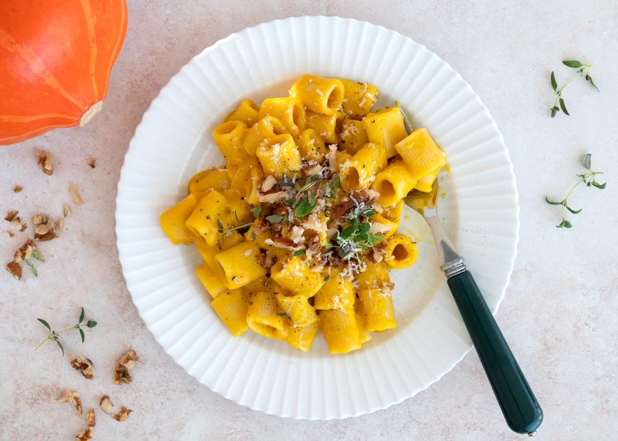

# Pasta med græskarsauce

* Kilde: https://www.valdemarsro.dk/pasta-med-graeskarsauce/
* Antal: **4 pers.**
* Tid i alt: **35 min.**
* Arbejdstid: **15 min.**

## Vejledende næringsindhold
Beregnede tal fra struktureret YAML-opskrift (både råvægt og estimeret spiseklar vægt efter vandoptag/fordampning).

| Variant                                            | Råvægt (g) | Spiseklar (ca., g) |  kcal | Protein (g) | Kulhydrat (g) | Fedt (g) | Kostfibre (g) |
| -------------------------------------------------- | ---------: | -----------------: | ----: | ----------: | ------------: | -------: | ------------: |
| Standard måltid (pr. 100 g spiseklar)              |         97 |                100 | 191.9 |         6.9 |          23.6 |      7.5 |           2.4 |
| Standard måltid (pr. portion, 1/4)                 |        417 |                428 |   822 |        29.6 |         100.9 |     32.1 |          10.1 |
| Standard måltid (hele opskriften)                  |       1666 |               1713 |  3287 |       118.5 |         403.7 |    128.5 |          40.3 |
| Kun basisret (uden tilbehør) (pr. 100 g spiseklar) |         96 |                100 | 102.6 |         3.0 |           9.1 |      5.8 |           2.0 |
| Kun basisret (uden tilbehør) (pr. portion, 1/4)    |        283 |                295 |   303 |         8.9 |          26.9 |     17.2 |           6.0 |
| Kun basisret (uden tilbehør) (hele opskriften)     |       1134 |               1180 |  1211 |        35.6 |         107.4 |     68.9 |          23.8 |

Antagelser (kort): Cremet græskarsauce med hokkaido, røde linser og varme krydderier blendet med piskefløde og citron. Serveres med pasta, ristede valnødder og parmesan.

## Ingredienser
### Til græskarsauce
- [ ] 2 spiseskefulde olivenolie
- [ ] 2 løg, finthakket
- [ ] 2 fed hvidløg, finthakket
- [ ] 300 gram hokkaidogræskar, i små tern
- [ ] 100 gram røde linser
- [ ] 3 deciliter grøntsagsbouillon
- [ ] 0.5 teskefulde chiliflager
- [ ] 1 teskefuld tørret rosmarin
- [ ] 1 teskefuld fennikelfrø
- [ ] 10 gram ingefær, fintrevet
- [ ] 1 deciliter piskefløde
- [ ] 1 økologisk citron, fintrevet skal og saft
- [ ] Salt
- [ ] Friskkværnet peber

### Til servering (pasta)
- [ ] 400 gram pasta

### Topping ved servering
- [ ] 0.5 håndfulde frisk timian, plukket
- [ ] 50 gram valnøddekerner, grofthakkede
- [ ] 75 gram parmesan, friskrevet

## Fremgangsmåde
- [ ] Varm olivenolie op i en gryde ved middel varme og sautér løg i 5–6 minutter, til de er bløde og klare.
- [ ] Tilsæt hvidløg, hokkaidogræskar, røde linser, grøntsagsbouillon, chiliflager, tørret rosmarin, fennikelfrø og ingefær. Bring i kog.
- [ ] Læg låg på og lad det simre ved svag varme i 20–25 minutter, til græskar og linser er helt møre.
- [ ] Kog imens pasta i rigeligt letsaltet vand efter anvisningen på pakken, til den er al dente.
- [ ] Hæld græskarblandingen i en blender og kør, til saucen er helt cremet og ensartet.
- [ ] Tilsæt piskefløde samt fintrevet skal fra økologisk citron, og blend igen kort.
- [ ] Smag saucen godt til med friskpresset citronsaft, salt og friskkværnet peber.
- [ ] Vend den varme afdryppede pasta sammen med græskarsaucen, og anret i dybe tallerkener.
- [ ] Drys med frisk timian, grofthakkede valnøddekerner og friskrevet parmesan.
