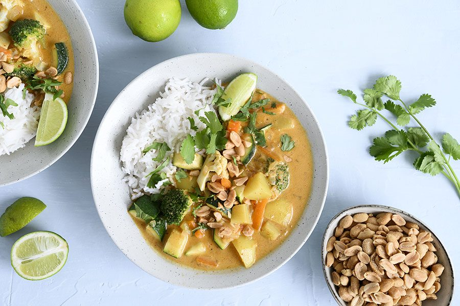

# Red thai curry

* Kilde: https://www.valdemarsro.dk/red-thai-curry/
* Antal: **4 pers.**
* Tid i alt: **30 min.**
* Arbejdstid: **20 min.**

## Vejledende næringsindhold
Beregnede tal fra struktureret YAML-opskrift (både råvægt og estimeret spiseklar vægt efter vandoptag/fordampning).

| Variant                                            | Råvægt (g) | Spiseklar (ca., g) |  kcal | Protein (g) | Kulhydrat (g) | Fedt (g) | Kostfibre (g) |
| -------------------------------------------------- | ---------: | -----------------: | ----: | ----------: | ------------: | -------: | ------------: |
| Standard måltid (pr. 100 g spiseklar)              |         92 |                100 | 132.9 |         2.7 |          12.0 |      7.7 |           1.6 |
| Standard måltid (pr. portion, 1/4)                 |        618 |                672 |   893 |        18.0 |          80.9 |     52.1 |          10.7 |
| Standard måltid (hele opskriften)                  |       2471 |               2690 |  3574 |        72.0 |         323.6 |    208.4 |          42.9 |
| Kun basisret (uden tilbehør) (pr. 100 g spiseklar) |        108 |                100 | 116.5 |         2.0 |           5.9 |      8.9 |           1.7 |
| Kun basisret (uden tilbehør) (pr. portion, 1/4)    |        535 |                494 |   576 |         9.7 |          28.9 |     44.0 |           8.6 |
| Kun basisret (uden tilbehør) (hele opskriften)     |       2141 |               1978 |  2304 |        38.9 |         115.7 |    175.9 |          34.4 |

Antagelser (kort): 2 dåser kokosmælk giver en meget rig sauce. Du kan nemt se forskellen med/uden ris og peanuts, eller skalere portionen til 650 kcal.

## Ingredienser
### Til curry
- [ ] 2 spiseskefulde olivenolie
- [ ] 2 løg, skåret i både
- [ ] 2 fed hvidløg, finthakkede
- [ ] 1 spiseskefuld frisk ingefær, fintrevet
- [ ] 1 spiseskefuld rød karrypasta
- [ ] 1.5 teskefulde karry (medium)
- [ ] 2 dåser kokosmælk
- [ ] 2 spiseskefulde fish sauce eller sojasauce
- [ ] 1 spiseskefuld brun farin
- [ ] 2 gulerødder, skåret i tynde stave
- [ ] 2 kartofler, skåret i tern
- [ ] 1 broccoli, skåret i buketter
- [ ] 1 squash, skåret i tern
- [ ] 100 gram blomkål, skåret i små buketter
- [ ] 1 økologisk lime, fintrevet skal og saft
- [ ] Salt
- [ ] Friskkværnet sort peber

### Til servering (ris)
- [ ] 3 deciliter basmatiris

### Topping (peanuts & koriander)
- [ ] 1 deciliter saltede peanuts, grofthakkede
- [ ] 1 håndfuld frisk koriander, grofthakket

## Fremgangsmåde
- [ ] Kog basmatiris efter anvisningen på pakken.
- [ ] Varm olivenolie op i en gryde ved middel varme. Sautér løg 3–4 minutter, til de er bløde og klare.
- [ ] Tilsæt hvidløg, frisk ingefær, rød karrypasta og karry (medium). Rør 1 minut, til det dufter.
- [ ] Tilsæt kokosmælk, fish sauce eller sojasauce, brun farin, gulerødder og kartofler. Bring i kog.
- [ ] Skru ned, læg låg på og lad det simre 15 minutter, til kartoflerne næsten er møre.
- [ ] Tilsæt broccoli, squash og blomkål. Lad det simre 5 minutter mere, til grøntsagerne er møre men stadig har lidt bid.
- [ ] Smag til med skal og saft fra økologisk lime, salt og friskkværnet peber.
- [ ] Servér i skåle med basmatiris, saltede peanuts og frisk koriander.
