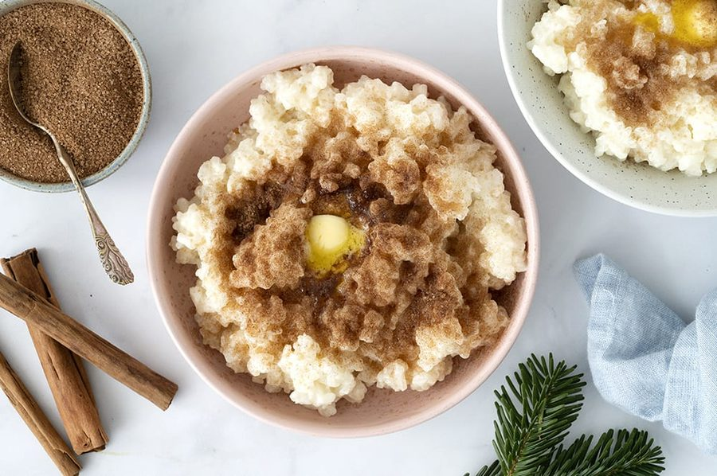

# Risengrød

* Kilde: https://www.valdemarsro.dk/risengroed/
* Antal: **4 pers.**
* Tid i alt: **60 min.**
* Arbejdstid: **20 min.**

## Vejledende næringsindhold
Beregnede tal fra struktureret YAML-opskrift (både råvægt og estimeret spiseklar vægt efter vandoptag/fordampning).

| Variant                                            | Råvægt (g) | Spiseklar (ca., g) |  kcal | Protein (g) | Kulhydrat (g) | Fedt (g) | Kostfibre (g) |
| -------------------------------------------------- | ---------: | -----------------: | ----: | ----------: | ------------: | -------: | ------------: |
| Standard måltid (pr. 100 g spiseklar)              |        111 |                100 | 154.3 |         4.3 |          24.2 |      4.2 |           0.8 |
| Standard måltid (pr. portion, 1/4)                 |        698 |                631 |   973 |        27.2 |         152.7 |     26.8 |           4.8 |
| Standard måltid (hele opskriften)                  |       2793 |               2523 |  3892 |       108.8 |         610.9 |    107.1 |          19.1 |
| Kun basisret (uden tilbehør) (pr. 100 g spiseklar) |        111 |                100 | 140.2 |         4.4 |          23.3 |      3.1 |           0.6 |
| Kun basisret (uden tilbehør) (pr. portion, 1/4)    |        676 |                608 |   852 |        27.1 |         142.0 |     18.6 |           3.5 |
| Kun basisret (uden tilbehør) (hele opskriften)     |       2703 |               2433 |  3410 |       108.2 |         568.0 |     74.2 |          13.8 |

Antagelser (kort): Klassisk risengrød. Kanelsukker og smørklat er skilt ud i et separat topping-modul.

## Ingredienser
### Til grøden
- [ ] 6 deciliter grødris, skyllet
- [ ] 1 deciliter vand
- [ ] 2000 milliliter mælk (sødmælk eller letmælk)
- [ ] 0.5 teskefulde salt

### Til servering (kanelsukker & smør)
- [ ] 40 gram smør, smørklat (ca. 10 g pr. portion)
- [ ] 40 gram sukker, til kanelsukker
- [ ] 2 teskefulde kanel

## Fremgangsmåde
- [ ] Kom skyllede grødris og vand i en gryde. Bring i kog under omrøring, til vandet næsten er væk.
- [ ] Hæld mælk (sødmælk eller letmælk) i og varm op til lige under kogepunktet, mens du rører, så det ikke brænder på.
- [ ] Skru ned til lav varme, læg låg på og lad grøden simre roligt. Rør cirka hver 10. minut.
- [ ] Efter cirka 45–60 minutter: Risene skal være møre, og grøden skal være cremet og tyk.
- [ ] Smag til med salt. Server varm med smør, kanel og sukker.
