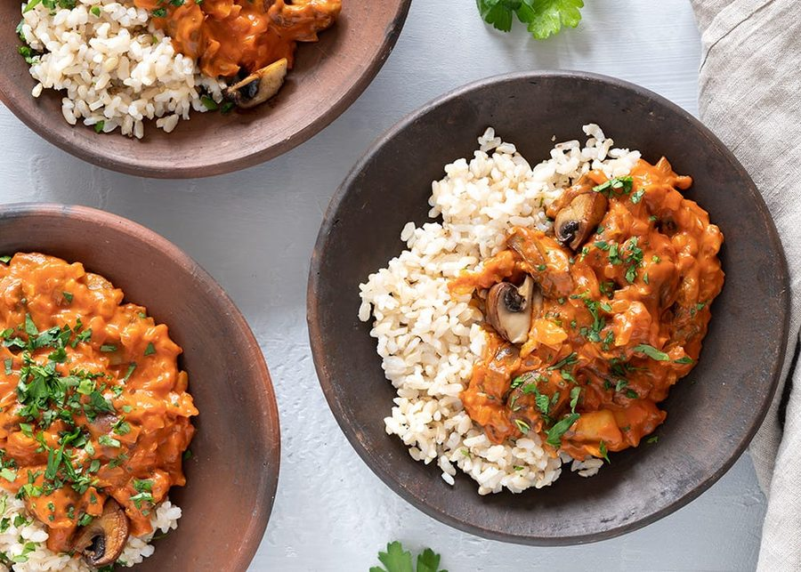

# Svampe stroganoff

* Kilde: https://www.valdemarsro.dk/svampe-stroganoff/
* Antal: **4 pers.**
* Tid i alt: **45 min.**
* Arbejdstid: **30 min.**

## Vejledende næringsindhold
Beregnede tal fra struktureret YAML-opskrift (både råvægt og estimeret spiseklar vægt efter vandoptag/fordampning).

| Variant                                            | Råvægt (g) | Spiseklar (ca., g) |  kcal | Protein (g) | Kulhydrat (g) | Fedt (g) | Kostfibre (g) |
| -------------------------------------------------- | ---------: | -----------------: | ----: | ----------: | ------------: | -------: | ------------: |
| Standard måltid (pr. 100 g spiseklar)              |         89 |                100 | 118.7 |         3.0 |          15.1 |      4.8 |           2.0 |
| Standard måltid (pr. portion, 1/4)                 |        348 |                392 |   465 |        11.7 |          59.2 |     18.6 |           7.8 |
| Standard måltid (hele opskriften)                  |       1390 |               1567 |  1860 |        46.8 |         236.9 |     74.6 |          31.0 |
| Kun basisret (uden tilbehør) (pr. 100 g spiseklar) |        122 |                100 | 103.3 |         3.0 |           5.4 |      7.4 |           2.3 |
| Kun basisret (uden tilbehør) (pr. portion, 1/4)    |        280 |                229 |   236 |         6.8 |          12.2 |     16.9 |           5.3 |
| Kun basisret (uden tilbehør) (hele opskriften)     |       1120 |                915 |   945 |        27.2 |          49.0 |     67.6 |          21.3 |

Antagelser (kort): 3 dl brune ris = ca. 300 g tørvægt (ca. 750 g kogt). Svampe afgiver og fordamper væske ved hård stegning.

## Ingredienser
### Til stroganoff
- [ ] 1 spiseskefuld olivenolie
- [ ] 1 spiseskefuld smør
- [ ] 250 gram champignon, skåret i kvarte
- [ ] 225 gram andre svampe (f.eks. kantareller), groft skåret
- [ ] 2 løg, finthakkede
- [ ] 4 fed hvidløg, finthakkede
- [ ] 1 spiseskefuld sød paprika
- [ ] 1 spiseskefuld røget paprika
- [ ] 1 spiseskefuld hvedemel
- [ ] 5 spiseskefulde tomatpuré
- [ ] 2 deciliter grøntsagsbouillon
- [ ] 1 deciliter piskefløde
- [ ] Salt
- [ ] Friskkværnet sort peber

### Til servering (brune ris)
- [ ] 3 deciliter brune ris, kogt efter anvisning på pakken
- [ ] 1 håndfuld bredbladet persille, grofthakket

## Fremgangsmåde
- [ ] Kog brune ris efter anvisningen på pakken.
- [ ] Varm olivenolie og smør op på en stor pande ved høj varme. Steg champignon 6–8 minutter, til de får stegeskorpe og væden er fordampet.
- [ ] Skru ned til middel varme. Tilsæt andre svampe (f.eks. kantareller), løg og hvidløg og sautér 5–7 minutter, til løgene er bløde.
- [ ] Drys sød paprika, røget paprika og hvedemel over og rør rundt i 30 sekunder.
- [ ] Tilsæt tomatpuré, grøntsagsbouillon og piskefløde. Lad det simre 10 minutter, til saucen er cremet og kan dække bagsiden af en ske.
- [ ] Smag til med salt og friskkværnet peber. Server med brune ris og bredbladet persille.
