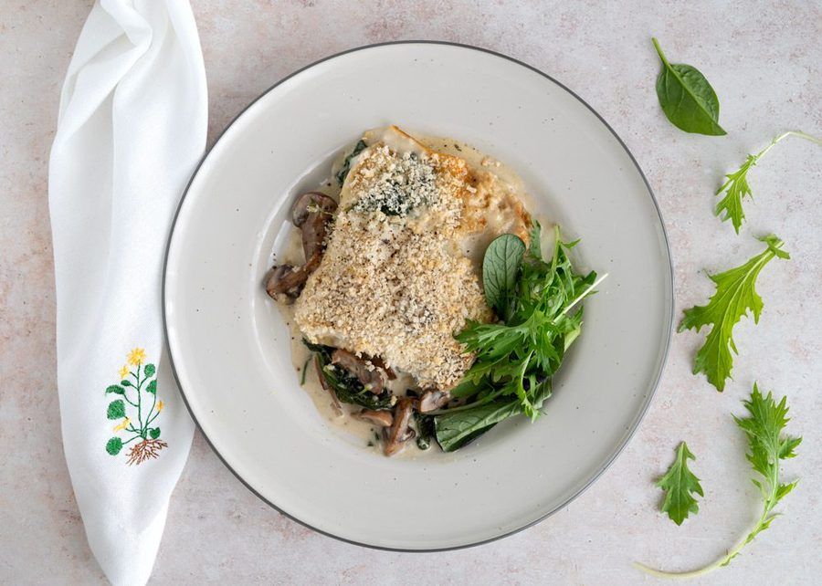

# Svampelasagne

* Kilde: https://www.valdemarsro.dk/svampelasagne/
* Antal: **4 pers.**
* Tid i alt: **120 min.**
* Arbejdstid: **90 min.**

## Vejledende næringsindhold
Beregnede tal fra struktureret YAML-opskrift (både råvægt og estimeret spiseklar vægt efter vandoptag/fordampning).

| Variant                               | Råvægt (g) | Spiseklar (ca., g) |  kcal | Protein (g) | Kulhydrat (g) | Fedt (g) | Kostfibre (g) |
| ------------------------------------- | ---------: | -----------------: | ----: | ----------: | ------------: | -------: | ------------: |
| Standard måltid (pr. 100 g spiseklar) |        113 |                100 | 179.8 |         5.9 |          11.6 |     11.0 |           1.6 |
| Standard måltid (pr. portion, 1/4)    |        539 |                476 |   856 |        28.1 |          55.0 |     52.4 |           7.7 |
| Standard måltid (hele opskriften)     |       2156 |               1905 |  3425 |       112.3 |         220.2 |    209.4 |          30.6 |
| Med alle tilvalg (pr. portion, 1/4)   |        582 |                519 |   901 |        28.7 |          57.1 |     56.0 |           8.5 |
| Med alle tilvalg (hele opskriften)    |       2328 |               2077 |  3603 |       114.8 |         228.3 |    224.0 |          33.8 |

Antagelser (kort): Cremet svampelasagne med hjemmelavet mornaysauce og sprød panko/parmesan-top. Salat med sennepsvinaigrette kan slås til/fra som modul.

## Ingredienser
### Til svampesaucen
- [ ] 20 gram tørrede karl johan-svampe, udblødt efter anvisning og afdryppet
- [ ] 3 spiseskefulde olivenolie
- [ ] 25 gram smør
- [ ] 400 gram champignon, skåret i kvarte
- [ ] 1 løg, finthakket
- [ ] 3 fed hvidløg, fintrevet
- [ ] 0.5 teskefulde tørret rosmarin
- [ ] 300 gram spinat
- [ ] 2 deciliter hvidvin
- [ ] 2 deciliter piskefløde
- [ ] 1 økologisk citron (fintrevet skal og lidt saft)
- [ ] Salt
- [ ] Friskkværnet sort peber

### Mornaysauce & lasagneplader
- [ ] 25 gram smør
- [ ] 25 gram hvedemel
- [ ] 3 deciliter mælk
- [ ] 1 knivspids muskatnød
- [ ] 125 gram frisk mozzarella
- [ ] 200 gram friske lasagneplader
- [ ] 50 gram pankorasp
- [ ] 50 gram parmesan (eller anden hård ost), fintrevet

### Til servering (salat & dressing - valgfrit)
- [ ] 125 gram blandet salat (valgfrit)
- [ ] 0.5 håndfulde frisk timian (valgfrit)
- [ ] 1 spiseskefuld olivenolie (valgfrit)
- [ ] 1 spiseskefuld citronsaft (valgfrit)
- [ ] 1 teskefuld honning (valgfrit)
- [ ] 1 teskefuld dijonsennep (valgfrit)

## Fremgangsmåde
- [ ] Tænd ovnen på 200°C varmluft.
- [ ] Læg tørrede karl johan-svampe i blød efter anvisningen på pakken. Hæld væden fra og lad dem dryppe af.
- [ ] Varm olivenolie op på en stor pande ved høj varme. Smelt smør og lad det bruse af.
- [ ] Steg champignon 6–8 minutter, til de får stegeskorpe og væden er fordampet.
- [ ] Skru ned til middel varme. Tilsæt løg, hvidløg, tørret rosmarin, spinat og de udblødte svampe. Varm, til løgene er bløde og spinaten er faldet sammen.
- [ ] Hæld hvidvin og piskefløde i. Bring kort i kog. Smag til med skal og lidt saft fra økologisk citron (fintrevet skal og lidt saft), salt og friskkværnet peber.

### Mornaysauce, samling og bagning
- [ ] Smelt smør i en gryde ved middel varme. Pisk hvedemel i, til det samler sig.
- [ ] Pisk mælk i lidt ad gangen, til saucen er glat og tykner.
- [ ] Pisk frisk mozzarella i, til den smelter. Smag til med muskatnød, salt og peber.
- [ ] Fordel et tyndt lag svampesauce i et smurt ovnfast fad. Læg friske lasagneplader på, fordel lidt mornaysauce, og fortsæt lag for lag. Slut med mornaysauce.
- [ ] Drys pankorasp og parmesan (eller anden hård ost) over. Bag cirka 15 minutter, til lasagnepladerne er møre, og toppen er gylden og sprød.

### Servering (valgfrit)
- [ ] Rør olivenolie, citronsaft, honning og dijonsennep sammen. Smag til med salt og peber.
- [ ] Vend dressingen med blandet salat og top evt. med frisk timian. Servér ved siden af lasagnen.
