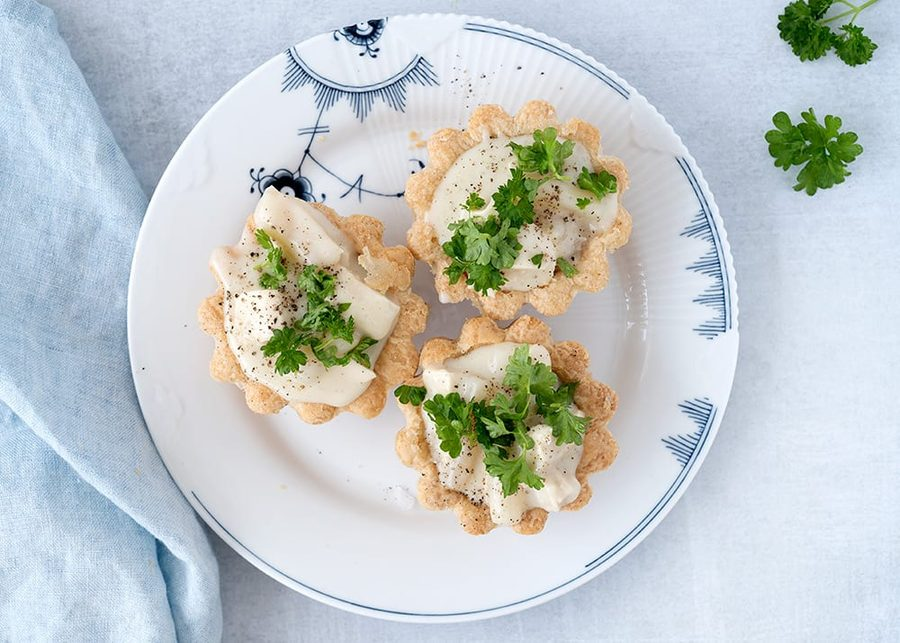

# Tarteletter med høns i asparges

* Kilde: https://www.valdemarsro.dk/tarteletter-hoens-asparges/
* Antal: **4 pers.**
* Tid i alt: **45 min.**
* Arbejdstid: **30 min.**

## Vejledende næringsindhold
Beregnede tal fra struktureret YAML-opskrift (både råvægt og estimeret spiseklar vægt efter vandoptag/fordampning).

| Variant                                            | Råvægt (g) | Spiseklar (ca., g) |  kcal | Protein (g) | Kulhydrat (g) | Fedt (g) | Kostfibre (g) |
| -------------------------------------------------- | ---------: | -----------------: | ----: | ----------: | ------------: | -------: | ------------: |
| Standard måltid (pr. 100 g spiseklar)              |        105 |                100 | 131.4 |         7.6 |           9.1 |      6.9 |           0.9 |
| Standard måltid (pr. portion, 1/4)                 |        448 |                427 |   561 |        32.4 |          38.8 |     29.4 |           3.7 |
| Standard måltid (hele opskriften)                  |       1794 |               1710 |  2246 |       129.6 |         155.3 |    117.6 |          14.6 |
| Kun basisret (uden tilbehør) (pr. 100 g spiseklar) |        106 |                100 |  79.8 |         7.9 |           3.7 |      3.6 |           0.6 |
| Kun basisret (uden tilbehør) (pr. portion, 1/4)    |        385 |                364 |   290 |        28.7 |          13.5 |     13.2 |           2.3 |
| Kun basisret (uden tilbehør) (hele opskriften)     |       1539 |               1455 |  1160 |       114.8 |          54.1 |     52.7 |           9.3 |

Antagelser (kort): Klassisk dansk ret med hønsekød i hvid sauce med asparges, serveret i tarteletter. Hønsekødet kan koges af en hel suppehøne eller frosne hønsebryst. Uden for sæson kan dåseasparges bruges. Opskriften er fra Valdemarsro.

## Ingredienser
### Hønsekød og sauce
- [ ] 400 gram hønsebryst, kogt
- [ ] 3 deciliter grøntsagsbouillon
- [ ] 1 gulerod, i tern
- [ ] 1 løg, i tern
- [ ] 2 laurbærblade
- [ ] hele peberkorn (ca. 10)
- [ ] salt
- [ ] 40 gram smør
- [ ] 2 spiseskefulde hvedemel
- [ ] 4 deciliter mælk
- [ ] 200 gram asparges, snittet

### Til servering (tarteletter)
- [ ] 12 tarteletter

### Pynt
- [ ] 1 håndfuld persille
- [ ] friskkværnet sort peber

## Fremgangsmåde
- [ ] Kom hønsebryst i en gryde med grøntsagsbouillon, gulerod, løg, salt, hele peberkorn (ca. 10) og laurbærblade. Lad det simrekoge i 15 minutter. Gem 3 dl kogevand til saucen.
- [ ] Smelt smør i en gryde og pisk hvedemel i til en melbolle. Pisk mælk i lidt ad gangen, til saucen er helt jævn.
- [ ] Kog saucen op og lad den koge 1–2 minutter under omrøring. Smag til med salt og peber, og tynd evt. ud med kogevandet fra hønsekødet, til konsistensen er passende.
- [ ] Damp asparges i kogende letsaltet vand i 3–4 minutter og dræn dem af.
- [ ] Skær hønsekødet i tern og kom det sammen med asparges i saucen.

### Servering
- [ ] Lun tarteletter i ovnen efter anvisning på pakken.
- [ ] Fyld de lune tarteletter med saucen og pynt med persille. Kværn friskkværnet sort peber over og drys evt. med lidt flagesalt.
