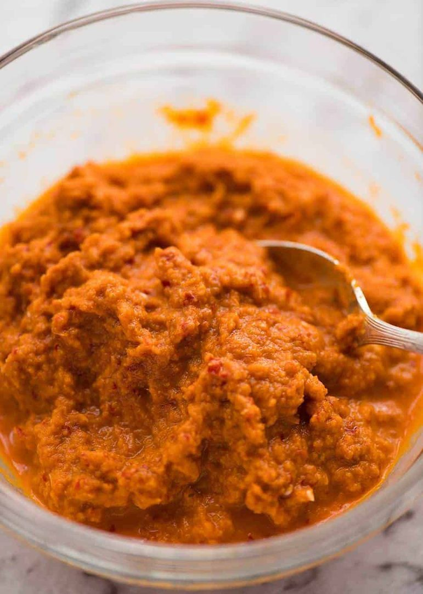

# Thai rød karrypasta

* Kilde: https://www.recipetineats.com/thai-red-curry-paste/
* Antal: **2 pers.**
* Tid i alt: **40 min.**
* Arbejdstid: **10 min.**

## Vejledende næringsindhold
Beregnede tal fra struktureret YAML-opskrift (både råvægt og estimeret spiseklar vægt efter vandoptag/fordampning).

| Variant                               | Råvægt (g) | Spiseklar (ca., g) | kcal | Protein (g) | Kulhydrat (g) | Fedt (g) | Kostfibre (g) |
| ------------------------------------- | ---------: | -----------------: | ---: | ----------: | ------------: | -------: | ------------: |
| Standard måltid (pr. 100 g spiseklar) |        102 |                100 | 91.1 |         5.0 |          11.3 |      2.6 |           5.1 |
| Standard måltid (pr. portion, 1/2)    |        107 |                105 |   95 |         5.2 |          11.8 |      2.7 |           5.3 |
| Standard måltid (hele opskriften)     |        214 |                209 |  191 |        10.4 |          23.7 |      5.4 |          10.7 |

Antagelser (kort): Hjemmelavet thai rød karrypasta (nok til 2 gryderetter á 4 personer).

## Ingredienser
### Til karrypastaen
- [ ] 16 tørrede røde chilier, klippet i ca. 1 cm stykker (kerner rystet ud efter smag)
- [ ] 2 spiseskefulde citrongræs, i tynde skiver (tørre yderblade fjernet)
- [ ] 1 spiseskefuld galanga (eller frisk ingefær + ekstra limeskal), fintrevet
- [ ] 4 fed hvidløg
- [ ] 1 spiseskefuld reje-pasta i olie (eller 2 tsk belacan)
- [ ] 0.5 teskefulde stødt koriander
- [ ] 0.5 teskefulde stødt spidskommen
- [ ] 1 spiseskefuld korianderstængler (evt. med lidt rod), grofthakket
- [ ] 2 røde skalotteløg, grofthakkede
- [ ] 1 teskefuld fintrevet limeskal
- [ ] 0.6 deciliter udblødningsvand fra chilierne

## Fremgangsmåde
- [ ] Smag på en tørret chili for at vurdere styrken. Kom tørrede røde chilier i en skål og hæld ca. 7 dl kogende vand over. Lad udbløde ca. 30 minutter.
- [ ] Tag chilierne op og gem udblødningsvandet.
- [ ] Kom chilierne i en blender eller kraftig foodprocessor.
- [ ] Tilsæt citrongræs, galanga (eller frisk ingefær + ekstra limeskal), hvidløg, reje-pasta i olie (eller 2 tsk belacan), stødt koriander, stødt spidskommen, korianderstængler (evt. med lidt rod), røde skalotteløg og fintrevet limeskal.
- [ ] Tilsæt udblødningsvand fra chilierne og blend til en så glat pasta som muligt. Tilsæt en smule mere vand hvis nødvendigt.
- [ ] Opbevar i en lufttæt beholder i køleskab (et par dage), eller frys i små portioner.
