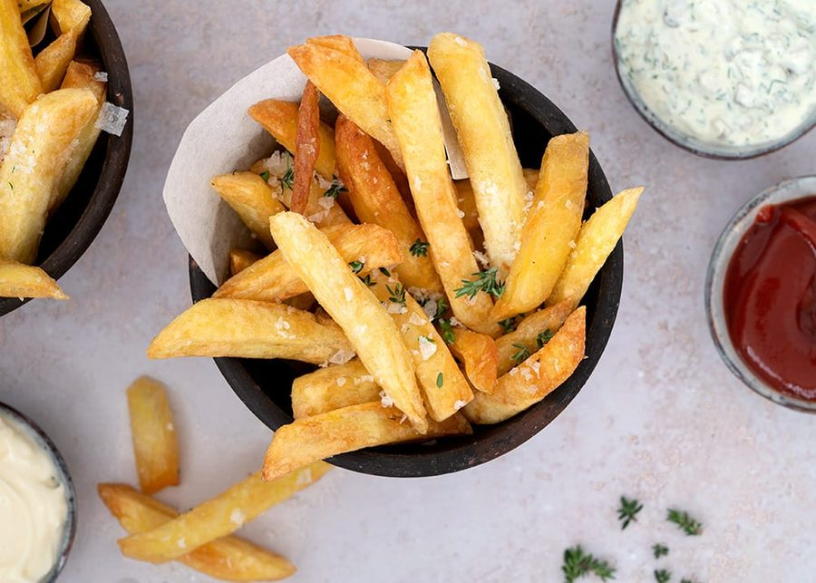

# Valdemarsro-style Pommes frites

* Kilde: https://www.valdemarsro.dk/pommes-frites/
* Antal: **4 pers.**
* Tid i alt: **120 min.**
* Arbejdstid: **60 min.**

## Vejledende næringsindhold
Beregnede tal fra struktureret YAML-opskrift (både råvægt og estimeret spiseklar vægt efter vandoptag/fordampning).

| Variant                               | Råvægt (g) | Spiseklar (ca., g) |  kcal | Protein (g) | Kulhydrat (g) | Fedt (g) | Kostfibre (g) |
| ------------------------------------- | ---------: | -----------------: | ----: | ----------: | ------------: | -------: | ------------: |
| Standard måltid (pr. 100 g spiseklar) |        113 |                100 | 144.6 |         2.0 |          16.0 |      7.6 |           1.4 |
| Standard måltid (pr. portion, 1/4)    |        449 |                398 |   576 |         8.0 |          63.7 |     30.4 |           5.6 |
| Standard måltid (hele opskriften)     |       1795 |               1592 |  2302 |        32.0 |         254.8 |    121.6 |          22.4 |

Antagelser (kort): Dobbeltfriterede sprøde pommes frites. Kun det faktiske olieoptag i fritterne (~120 g i alt, og ikke de 2 liter fritureolie i gryden) indgår i kalorierne.

## Ingredienser
### Til fritterne
- [ ] 8 bagekartofler, skrubbede eller skrællet
- [ ] 3 spiseskefulde æblecidereddike
- [ ] 2 teskefulde salt til kogevandet
- [ ] 120 gram fritureolie (heraf optages ~120 g i fritterne; brug 2 liter i gryden)
- [ ] 1 spiseskefuld flagesalt til servering

## Fremgangsmåde
- [ ] Skær bagekartofler i lige store pommes frites.
- [ ] Læg dem i koldt vand i 60 minutter. Skift gerne vandet et par gange, så stivelsen skylles af.
- [ ] Kog vand op i en gryde. Tilsæt salt til kogevandet og æblecidereddike.
- [ ] Kog kartoflerne cirka 10 minutter, til de er næsten møre (de skal kunne holde formen). Hæld vandet fra.
- [ ] Lad fritterne køle af og tørre på et viskestykke.

### Første og anden fritering
- [ ] Varm 2 liter fritureolie (heraf optages ~120 g i fritterne; brug 2 liter i gryden) op til cirka 150°C. Friter en lille portion ad gangen i cirka 5 minutter, til de er lyse og kun lige begynder at tage farve. Læg dem på bagepapir eller køkkenrulle.
- [ ] Lige før servering: Varm olien op til 180°C. Friter igen i små portioner, til de er sprøde og dybt gyldne.
- [ ] Lad dem dryppe af og drys med flagesalt til servering. Server med det samme.
