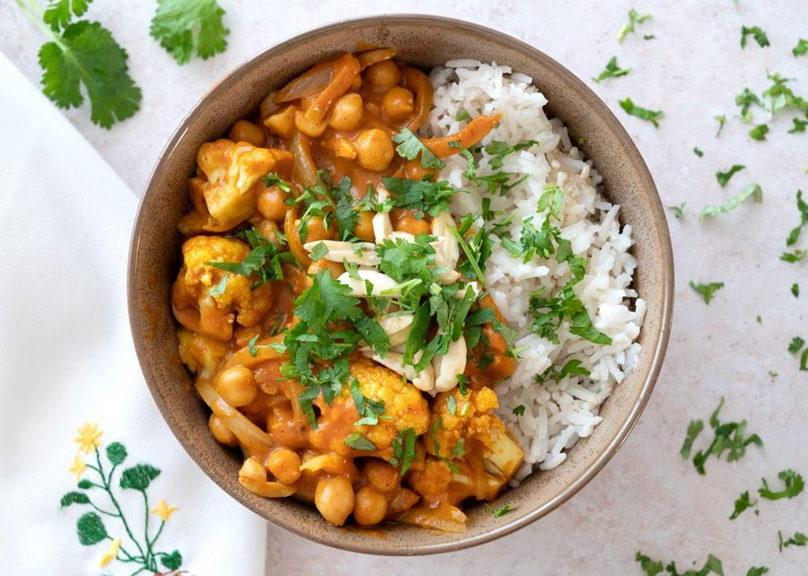

# Vegetar Korma med blomkål og kikærter

* Kilde: https://www.valdemarsro.dk/vegetar-korma/
* Antal: **4 pers.**
* Tid i alt: **30 min.**
* Arbejdstid: **30 min.**

## Vejledende næringsindhold
Beregnede tal fra struktureret YAML-opskrift (både råvægt og estimeret spiseklar vægt efter vandoptag/fordampning).

| Variant                                            | Råvægt (g) | Spiseklar (ca., g) |  kcal | Protein (g) | Kulhydrat (g) | Fedt (g) | Kostfibre (g) |
| -------------------------------------------------- | ---------: | -----------------: | ----: | ----------: | ------------: | -------: | ------------: |
| Standard måltid (pr. 100 g spiseklar)              |         89 |                100 | 143.0 |         3.7 |          14.4 |      7.2 |           2.3 |
| Standard måltid (pr. portion, 1/4)                 |        487 |                547 |   782 |        20.4 |          78.7 |     39.5 |          12.8 |
| Standard måltid (hele opskriften)                  |       1949 |               2188 |  3130 |        81.4 |         314.7 |    158.1 |          51.0 |
| Kun basisret (uden tilbehør) (pr. 100 g spiseklar) |        109 |                100 | 144.5 |         4.1 |           7.4 |     10.2 |           3.1 |
| Kun basisret (uden tilbehør) (pr. portion, 1/4)    |        420 |                384 |   555 |        15.8 |          28.4 |     39.0 |          11.8 |
| Kun basisret (uden tilbehør) (hele opskriften)     |       1679 |               1536 |  2219 |        63.0 |         113.6 |    156.2 |          47.3 |

Antagelser (kort): Mild og cremet vegetar korma med blomkål, kikærter og mandler. Ris er adskilt i eget modul.

## Ingredienser
### Til korma
- [ ] 2 spiseskefulde olie
- [ ] 2 løg, finthakkede
- [ ] 1 spiseskefuld garam masala
- [ ] 0.5 teskefulde chiliflager
- [ ] 1 teskefuld stødt gurkemeje
- [ ] 4 fed hvidløg, finthakkede
- [ ] 1 spiseskefuld ingefær, fintrevet
- [ ] 1 saft af 1 lime
- [ ] 400 milliliter kokosmælk
- [ ] 1 blomkål, delt i små buketter
- [ ] 1 dåse kikærter (drænet), drænede og skyllede
- [ ] 75 gram koncentreret tomatpuré
- [ ] 1 deciliter græsk yoghurt 10 %
- [ ] 75 gram mandler, smuttede og grofthakkede
- [ ] Salt
- [ ] Friskkværnet sort peber

### Til servering (ris)
- [ ] 3 deciliter basmatiris
- [ ] 1 håndfuld frisk koriander, grofthakket (valgfrit)

## Fremgangsmåde
- [ ] Kog basmatiris efter anvisningen på pakken.
- [ ] Varm olie op i en gryde ved middel varme. Sautér løg 6–8 minutter, til de er bløde og klare.
- [ ] Tilsæt garam masala, chiliflager, stødt gurkemeje, hvidløg og ingefær. Rør 30–60 sekunder, til det dufter.
- [ ] Tilsæt saft af 1 lime og kokosmælk og bring i kog.
- [ ] Tilsæt blomkål, kikærter (drænet) og koncentreret tomatpuré. Læg låg på og lad det simre 10–15 minutter, til blomkålen er mør.
- [ ] Sluk for varmen. Rør græsk yoghurt 10 % og halvdelen af mandler i.
- [ ] Smag til med salt og friskkværnet peber.
- [ ] Servér med ris, resten af mandlerne og evt. frisk koriander.
