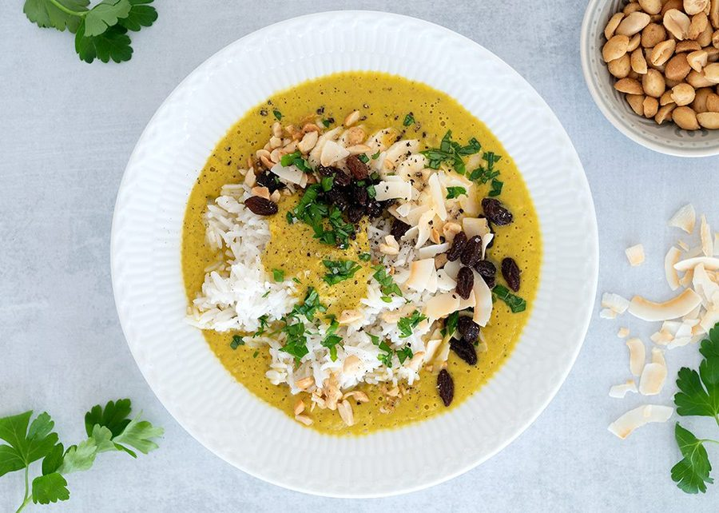

# Vegetar ristaffel med grøntsager

* Kilde: https://www.valdemarsro.dk/vegetar-ristaffel-med-groentsager/
* Antal: **4 pers.**
* Tid i alt: **30 min.**
* Arbejdstid: **30 min.**

## Vejledende næringsindhold
Beregnede tal fra struktureret YAML-opskrift (både råvægt og estimeret spiseklar vægt efter vandoptag/fordampning).

| Variant                                            | Råvægt (g) | Spiseklar (ca., g) |  kcal | Protein (g) | Kulhydrat (g) | Fedt (g) | Kostfibre (g) |
| -------------------------------------------------- | ---------: | -----------------: | ----: | ----------: | ------------: | -------: | ------------: |
| Standard måltid (pr. 100 g spiseklar)              |         87 |                100 | 105.5 |         2.3 |          15.4 |      3.8 |           1.7 |
| Standard måltid (pr. portion, 1/4)                 |        476 |                546 |   576 |        12.6 |          83.9 |     21.0 |           9.3 |
| Standard måltid (hele opskriften)                  |       1906 |               2185 |  2304 |        50.5 |         335.6 |     84.1 |          37.4 |
| Kun basisret (uden tilbehør) (pr. 100 g spiseklar) |        109 |                100 |  50.6 |         1.2 |           4.4 |      3.0 |           1.5 |
| Kun basisret (uden tilbehør) (pr. portion, 1/4)    |        326 |                301 |   152 |         3.6 |          13.1 |      9.1 |           4.5 |
| Kun basisret (uden tilbehør) (hele opskriften)     |       1306 |               1202 |   608 |        14.3 |          52.4 |     36.5 |          17.9 |

Antagelser (kort): Cremet blendet grøntsagskarrysauce med klassiske ristaffel-toppings (banan, kokos, rosiner og peanuts).

## Ingredienser
### Til karrysaucen
- [ ] 1 teskefuld karry (medium)
- [ ] 1 teskefuld stødt spidskommen
- [ ] 1 teskefuld stødt koriander
- [ ] 1 spiseskefuld olivenolie
- [ ] 1 løg, finthakket
- [ ] 2 fed hvidløg, finthakkede
- [ ] 1 teskefuld rød karrypasta
- [ ] 1 teskefuld stødt gurkemeje
- [ ] 250 gram blomkål, i små buketter
- [ ] 75 gram gulerod, groftrevet
- [ ] 250 gram squash, groftrevet
- [ ] 1 æble, groftrevet
- [ ] 4 deciliter grøntsagsbouillon
- [ ] 0.5 deciliter piskefløde
- [ ] 4 teskefulde saft af 0,5 citron
- [ ] Salt
- [ ] Friskkværnet sort peber

### Til servering (ris)
- [ ] 3 deciliter basmatiris

### Toppings
- [ ] 30 gram kokosflager eller kokosmel
- [ ] 30 gram rosiner
- [ ] 2 bananer, skåret i skiver
- [ ] 50 gram saltede peanuts
- [ ] 1 håndfuld bredbladet persille, finthakket

## Fremgangsmåde
- [ ] Kog basmatiris efter anvisningen på pakken.
- [ ] Rist karry (medium), stødt spidskommen og stødt koriander i en tør gryde ved middel varme i 30–60 sekunder, til det dufter.
- [ ] Tilsæt olivenolie, løg og hvidløg og sautér 4–5 minutter, til løgene er bløde og klare.
- [ ] Tilsæt rød karrypasta og stødt gurkemeje og rør 30 sekunder.
- [ ] Tilsæt blomkål, gulerod, squash, æble og grøntsagsbouillon. Bring i kog.
- [ ] Læg låg på og lad det simre cirka 5 minutter, til blomkålen er mør.
- [ ] Blend saucen helt cremet og hæld den tilbage i gryden.
- [ ] Tilsæt piskefløde og saft af 0,5 citron. Smag til med salt og peber. Justér med lidt ekstra bouillon, hvis den er for tyk.
- [ ] Servér ris og karrysauce med kokosflager eller kokosmel, rosiner, bananer, saltede peanuts og bredbladet persille i skåle på bordet.
